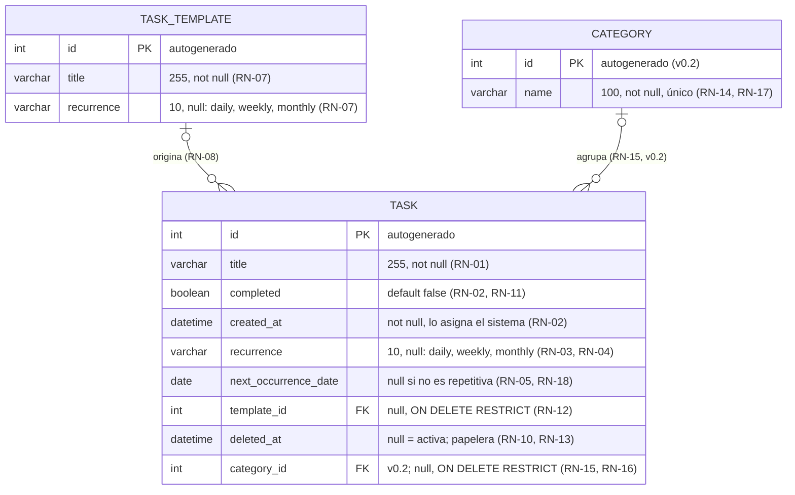

# Análisis técnico — Lista de Tareas

> Fase 2 (ANÁLISIS). Traduce la documentación funcional (`docs/app/lista-de-tareas.md`) al stack del CLAUDE.md: PHP 8.3, Symfony 7, Doctrine ORM, PHPUnit y Angular.
>
> Adapta `docs/analisis-diseño.md` (AppTodoList, en .NET). Las diferencias con ese documento se explican en la sección 9.
>
> Estado: **pendiente de nueva firma** — firmado por hispafox el 2026-11-24 (CRITERIO de la Fase 2); cambiado después para añadir las categorías de tareas (versión 0.2) y la fecha de la siguiente ocurrencia al crear y modificar (RN-18), y los errores `404`/`405` de rutas de `/api` en problem+json (issue #23).

## 1. Stack

| Tecnología | Versión | Rol |
|---|---|---|
| PHP | 8.3+ | Lenguaje del backend |
| Symfony | 7.x | Framework de la API REST (controladores con atributos) |
| Doctrine ORM + Migrations | 3.x | Persistencia y migraciones |
| SQLite → PostgreSQL | 3 → 16 | SQLite en la versión 0.1 ([ADR-0003](decisiones/0003-sqlite-en-la-version-0-1.md)); PostgreSQL en Docker más adelante ([ADR-0001](decisiones/0001-base-de-datos-postgresql.md)) |
| Symfony Validator + Serializer | 7.x | Validación y (de)serialización de los DTO |
| PHPUnit | 11.x | Tests unitarios y funcionales |
| Angular | última LTS | Frontend SPA, TypeScript estricto |

## 2. Arquitectura del backend

Capas planas y legibles, sin CQRS ni buses de mensajes.

| Capa | Carpeta | Responsabilidad |
|---|---|---|
| HTTP | `src/Controller/` | Recibe la petición, delega en el servicio y devuelve la respuesta. Sin lógica de negocio. |
| DTO | `src/Dto/` | Objetos de entrada (con reglas de validación) y de salida de la API. |
| Negocio | `src/Service/` | Reglas de negocio: crear, completar, generar ocurrencias, instanciar plantillas. |
| Datos | `src/Repository/` | Consultas con Doctrine (`ServiceEntityRepository`). |
| Dominio | `src/Entity/` | Entidades Doctrine y el enum `Recurrence`. |

```
backend/src/
├── Controller/
│   ├── TaskController.php
│   └── TaskTemplateController.php
├── Dto/
│   ├── TaskInput.php
│   ├── TaskOutput.php
│   ├── CompleteTaskOutput.php
│   ├── TaskTemplateInput.php
│   └── TaskTemplateOutput.php
├── Entity/
│   ├── Task.php
│   ├── TaskTemplate.php
│   └── Recurrence.php
├── Repository/
│   ├── TaskRepository.php
│   └── TaskTemplateRepository.php
└── Service/
    ├── TaskService.php
    ├── TaskTemplateService.php
    └── RecurrenceCalculator.php
```

**Reglas de diseño:**
- Inyección de dependencias por constructor (autowiring de Symfony); nunca `new` de servicios.
- Los controladores reciben los DTO con `#[MapRequestPayload]` y no tocan entidades directamente para validar.
- Las entidades no se serializan tal cual: la API devuelve siempre DTO de salida.
- Fechas con `DateTimeImmutable`. La fecha actual se obtiene con `ClockInterface` (Symfony Clock) para poder fijarla en los tests.
- Código, nombres y rutas en inglés ([ADR-0002](decisiones/0002-codigo-y-api-en-ingles.md)).

## 3. Modelo de datos

### Diagrama entidad-relación

Resume en un dibujo las tablas de este apartado. Las columnas aparecen con su nombre en la base de datos (`snake_case`); el detalle está en las tablas de debajo.



Lectura de las relaciones: una plantilla puede originar cero o muchas tareas, y una tarea viene de cero o una plantilla. Una categoría agrupa cero o muchas tareas, y una tarea tiene cero o una categoría (versión 0.2). `recurrence` guarda el valor del enum `Recurrence`.

### `Recurrence` (enum respaldado)

```php
enum Recurrence: string
{
    case Daily = 'daily';
    case Weekly = 'weekly';
    case Monthly = 'monthly';
}
```

### `Task` — tabla `task`

| Campo | Tipo PHP | Columna | Descripción | Regla |
|---|---|---|---|---|
| `id` | `int` | `id` serial PK | Autogenerado | |
| `title` | `string` | `varchar(255)` not null | Título | RN-01 |
| `completed` | `bool` | `boolean` default false | Estado | RN-02 |
| `createdAt` | `DateTimeImmutable` | `timestamp` not null | Lo asigna el servicio al crear | RN-02 |
| `recurrence` | `?Recurrence` | `varchar(10)` null | `null` = no repetitiva | RN-03, RN-04 |
| `nextOccurrenceDate` | `?DateTimeImmutable` | `date` null | Fecha prevista de la ocurrencia: hoy + periodicidad al crear o al cambiar la periodicidad (RN-18) y al generarse al completar (RN-05). `null` si no es repetitiva | RN-05, RN-18 |
| `template` | `?TaskTemplate` | `template_id` FK null, `ON DELETE RESTRICT` | Plantilla de origen | RN-08, RN-12 |
| `deletedAt` | `?DateTimeImmutable` | `timestamp` null | Fecha en que se movió a la papelera. `null` = activa | RN-10 |

Métodos de dominio:
- `isRecurring(): bool` → `recurrence !== null`.
- `isDeleted(): bool` → `deletedAt !== null`.
- `complete()`: lanza excepción si ya está completada (RN-11); no existe ningún método para volver a pendiente.
- `moveToTrash(DateTimeImmutable $now)` y `restore()`.

El borrado lógico se implementa a mano con `deletedAt` y métodos del repositorio (`findActive()`, `findDeleted()`), sin extensiones como Gedmo SoftDeleteable: es más explícito y fácil de seguir en la demo.

### `TaskTemplate` — tabla `task_template`

| Campo | Tipo PHP | Columna | Descripción | Regla |
|---|---|---|---|---|
| `id` | `int` | `id` serial PK | Autogenerado | |
| `title` | `string` | `varchar(255)` not null | Título por defecto | RN-07 |
| `recurrence` | `?Recurrence` | `varchar(10)` null | Periodicidad por defecto | RN-07 |

### `Category` — tabla `category` *(versión 0.2)*

| Campo | Tipo PHP | Columna | Descripción | Regla |
|---|---|---|---|---|
| `id` | `int` | `id` serial PK | Autogenerado | |
| `name` | `string` | `varchar(100)` not null | Nombre de la categoría | RN-14 |

Métodos de dominio: `rename(string $name)`, que recorta espacios y rechaza el nombre vacío (RN-14).

Unicidad del nombre (RN-17):
- `CategoryRepository::existsWithName(string $name, ?int $exceptId)` compara con `LOWER(TRIM(name))`. `CategoryService` lo consulta antes de crear o renombrar y, si ya existe, la API responde `422` con la violación en `name`.
- Índice único `uniq_category_name` sobre `name` como segunda barrera en la base de datos. Solo detecta duplicados exactos, porque el índice no ignora mayúsculas de forma portable entre SQLite y PostgreSQL; la regla completa la garantiza el servicio.

En `Task` se añade, también en la 0.2:

| Campo | Tipo PHP | Columna | Descripción | Regla |
|---|---|---|---|---|
| `category` | `?Category` | `category_id` FK null, `ON DELETE RESTRICT` | Categoría de la tarea | RN-15, RN-16 |

### Relaciones

- `Task` N → 0..1 `TaskTemplate` (`ManyToOne`, nullable, unidireccional). Para RN-12, `TaskRepository::countByTemplate()` cuenta las tareas de una plantilla, incluidas las de la papelera. La FK con `ON DELETE RESTRICT` es la segunda barrera en la base de datos.
- *(v0.2)* `Task` N → 0..1 `Category` (`ManyToOne`, nullable, unidireccional). Para RN-16, `TaskRepository::countByCategory()` cuenta las tareas de una categoría, incluidas las de la papelera; la FK con `ON DELETE RESTRICT` es la segunda barrera.

## 4. API REST

Prefijo `/api`. JSON en entrada y salida. Fechas en ISO 8601.

### Tareas — `/api/tasks`

| Verbo | Ruta | Descripción | OK | Errores | Func. |
|---|---|---|---|---|---|
| GET | `/api/tasks` | Listar tareas activas (excluye la papelera) | `200` + `TaskOutput[]` | — | F-01 |
| GET | `/api/tasks/{id}` | Detalle de una tarea activa | `200` + `TaskOutput` | `404` (también si está en la papelera) | F-02 |
| POST | `/api/tasks` | Crear | `201` + `TaskOutput` + cabecera `Location` | `422` | F-03 |
| PUT | `/api/tasks/{id}` | Modificar título o periodicidad | `200` + `TaskOutput` | `404`, `422` | F-04 |
| DELETE | `/api/tasks/{id}` | Mover a la papelera | `204` | `404` | F-05 |
| POST | `/api/tasks/{id}/complete` | Completar; si es repetitiva genera la siguiente ocurrencia | `200` + `CompleteTaskOutput` | `404`, `409` si ya está completada | F-06 |
| GET | `/api/tasks/trash` | Listar la papelera | `200` + `TaskOutput[]` | — | F-13 |
| POST | `/api/tasks/{id}/restore` | Restaurar desde la papelera | `200` + `TaskOutput` | `404`, `409` si no está en la papelera | F-14 |

Las tareas de la papelera responden `404` en detalle, `PUT`, `DELETE` y `complete` (RN-13); solo se pueden listar en `/trash` y restaurar.

### Plantillas — `/api/task-templates`

| Verbo | Ruta | Descripción | OK | Errores | Func. |
|---|---|---|---|---|---|
| GET | `/api/task-templates` | Listar | `200` + `TaskTemplateOutput[]` | — | F-07 |
| GET | `/api/task-templates/{id}` | Detalle | `200` + `TaskTemplateOutput` | `404` | F-08 |
| POST | `/api/task-templates` | Crear | `201` + `TaskTemplateOutput` | `422` | F-09 |
| PUT | `/api/task-templates/{id}` | Modificar | `200` + `TaskTemplateOutput` | `404`, `422` | F-10 |
| DELETE | `/api/task-templates/{id}` | Eliminar (definitivo) | `204` | `404`, `409` si tiene tareas asociadas | F-11 |
| POST | `/api/task-templates/{id}/instantiate` | Crear una tarea desde la plantilla | `201` + `TaskOutput` | `404` | F-12 |

### Categorías — `/api/categories` *(versión 0.2)*

| Verbo | Ruta | Descripción | OK | Errores | Func. |
|---|---|---|---|---|---|
| GET | `/api/categories` | Listar | `200` + `CategoryOutput[]` | — | F-15 |
| POST | `/api/categories` | Crear | `201` + `CategoryOutput` | `422` (también si el nombre ya existe, RN-17) | F-16 |
| PUT | `/api/categories/{id}` | Renombrar | `200` + `CategoryOutput` | `404`, `422` (también si el nombre ya existe, RN-17) | F-17 |
| DELETE | `/api/categories/{id}` | Eliminar (definitivo) | `204` | `404`, `409` si tiene tareas asociadas | F-18 |

La categoría de una tarea se asigna, cambia o quita con `categoryId` en `POST`/`PUT /api/tasks` (F-19). Un `categoryId` inexistente devuelve `422`.

### Formato de los DTO

```json
// TaskInput (POST/PUT /api/tasks) — el estado no se envía: se completa con /complete
{ "title": "Regar las plantas", "recurrence": "weekly", "categoryId": 3 }   // categoryId: v0.2, opcional

// TaskOutput
{ "id": 7, "title": "Regar las plantas", "completed": false,
  "createdAt": "2026-11-24T10:00:00+01:00", "recurrence": "weekly",
  "nextOccurrenceDate": "2026-12-01", "templateId": null, "deletedAt": null,
  "categoryId": 3 }                                                       // v0.2

// CategoryInput / CategoryOutput (v0.2)
{ "name": "Casa" }  /  { "id": 3, "name": "Casa" }

// CompleteTaskOutput
{ "task": { ...TaskOutput completada... }, "nextOccurrence": { ...TaskOutput nueva... } | null }
```

### Formato de errores

Todas las respuestas de error usan `application/problem+json` (RFC 9457, el formato *Problem Details* que Symfony ya genera):

```json
{ "type": "https://symfony.com/errors/validation", "title": "Validation Failed", "status": 422,
  "detail": "title: This value should not be blank.",
  "violations": [ { "propertyPath": "title", "title": "This value should not be blank." } ] }
```

- `400`: JSON mal formado.
- `404`: recurso inexistente, y también ruta de `/api` que no existe (por ejemplo `/api/nope` o `/api/tasks/abc`).
- `405`: la ruta existe pero no admite ese verbo (por ejemplo `PATCH /api/tasks/1`); lleva la cabecera `Allow` con los verbos admitidos.
- `409`: acción no permitida por el estado (completar una tarea ya completada, restaurar una tarea que no está en la papelera, eliminar una plantilla con tareas).
- `422`: datos que no cumplen las reglas de validación.

Toda petición bajo `/api` responde los errores en problem+json aunque no envíe la cabecera `Accept` ni coincida con ninguna ruta: un *subscriber* de `kernel.request` fija el formato de la petición a `json` antes de que actúe el router (issue #23). Las rutas fuera de `/api` conservan el comportamiento por defecto de Symfony.

## 5. Lógica de negocio

### `TaskService::create()` y `update()`

- `create(TaskInput $input): Task`: crea la tarea pendiente con `createdAt = now` (RN-02). Si es repetitiva, `nextOccurrenceDate = RecurrenceCalculator::next(today, recurrence)` (RN-18).
- `update(Task $task, TaskInput $input): Task`: cambia el título y, si la periodicidad es distinta de la actual, recalcula `nextOccurrenceDate` desde hoy, o la deja en `null` si la tarea deja de ser repetitiva (RN-03, RN-18). Si la periodicidad no cambia, la fecha se conserva.
- La entidad recibe la fecha ya calculada: el cálculo necesita el reloj y vive en el servicio.

### `TaskService::complete(Task $task): CompleteResult`

1. Si la tarea ya está completada → excepción de dominio (→ `409`, RN-11).
2. Marca `completed = true`.
3. Si `isRecurring()`: crea una `Task` nueva con el mismo `title`, `recurrence` y `template`, `completed = false`, `createdAt = now` y `nextOccurrenceDate = RecurrenceCalculator::next(today, recurrence)`.
4. Persiste ambas en una única transacción (`flush`).

`RecurrenceCalculator::next()` suma 1 día, 1 semana o 1 mes a la fecha del día en que se completa (RN-05). Con meses, si el día no existe en el mes siguiente se usa el último día de ese mes (31 de enero → 28/29 de febrero).

El estado solo cambia en `complete()`: `PUT` no acepta `completed` y no hay forma de volver a pendiente (RN-11).

### `TaskService::moveToTrash()` y `restore()`

- `moveToTrash()`: asigna `deletedAt = now`. La tarea deja de aparecer en `findActive()`.
- `restore()`: si no está en la papelera → excepción (→ `409`); si no, `deletedAt = null`. Conserva su estado (completada o pendiente).

### `TaskTemplateService::delete(TaskTemplate $template)`

Si `TaskRepository::countByTemplate($template) > 0` → excepción de dominio (→ `409`, RN-12). Si no, borra la plantilla definitivamente.

### `TaskTemplateService::instantiate(TaskTemplate $template): Task`

Crea una tarea pendiente con `title` y `recurrence` de la plantilla, vinculada a ella (RN-08). Si es repetitiva, `nextOccurrenceDate = RecurrenceCalculator::next(now, recurrence)`.

### Validación (DTO de entrada)

- `title`: `NotBlank`, `Length(max: 255)`.
- `recurrence`: `null` o uno de los valores del enum (`Choice` / deserialización al enum).
- *(v0.2)* `name` de categoría: `NotBlank`, `Length(max: 100)`. `categoryId` de tarea: `null` o el id de una categoría existente.

### `CategoryService::delete(Category $category)` *(versión 0.2)*

Si `TaskRepository::countByCategory($category) > 0` → excepción de dominio (→ `409`, RN-16). Si no, borra la categoría definitivamente.

## 6. Frontend Angular

```
frontend/src/app/
├── core/
│   ├── api/task-api.service.ts
│   ├── api/task-template-api.service.ts
│   ├── interceptors/error.interceptor.ts      // traduce problem+json a mensajes
│   └── models/                                 // Task, TaskTemplate, Recurrence
├── shared/
│   └── recurrence-label.pipe.ts                // daily → "Diaria"
└── features/
    ├── tasks/
    │   ├── task-list/                          // F-01, F-05, F-06
    │   ├── task-form/                          // F-03, F-04
    │   └── task-trash/                         // F-13, F-14
    └── task-templates/
        ├── template-list/                      // F-07, F-11, F-12
        └── template-form/                      // F-09, F-10
    └── categories/                             // v0.2
        └── category-list/                      // F-15 a F-18 (crear y renombrar en línea)
```

| Ruta | Pantalla | Qué hace |
|---|---|---|
| `/tasks` | Lista de tareas | Muestra pendientes y completadas; botones completar (solo en pendientes), editar y eliminar. |
| `/tasks/new`, `/tasks/:id/edit` | Formulario de tarea | Título, check "repetitiva" y selector de periodicidad. |
| `/tasks/trash` | Papelera | Tareas eliminadas con botón restaurar. |
| `/templates` | Lista de plantillas | Botones "crear tarea", editar y eliminar. Si la plantilla tiene tareas, muestra el aviso del `409`. |
| `/templates/new`, `/templates/:id/edit` | Formulario de plantilla | Igual que el de tarea. |
| `/categories` *(v0.2)* | Categorías | Lista con crear, renombrar y eliminar; aviso del `409` si tiene tareas. El formulario de tarea añade un selector de categoría opcional (F-19). |

- Componentes *standalone*, formularios reactivos tipados y `HttpClient`.
- Los textos de la interfaz, en castellano; el código, en inglés.
- En desarrollo, `proxy.conf.json` redirige `/api` al backend, así no hace falta CORS.

## 7. Requisitos no funcionales

| Tema | Decisión |
|---|---|
| Autenticación | Fuera de alcance según la documentación funcional. La tarea de seguridad de la Fase 4 del CLAUDE.md se redujo a validación de entrada y gestión de errores (2026-11-24). |
| Validación | Siempre en el backend (DTO + Validator). El frontend valida para la experiencia de uso, pero no sustituye al backend. |
| Rendimiento | Sin paginación (fuera de alcance). Volumen esperado bajo. |
| Calidad | PHPStan nivel 6 como mínimo y PHP-CS-Fixer en la CI (Fase 7). |
| Entorno | Versión 0.1: servidor local de Symfony CLI, SQLite y `ng serve`. Docker Compose con PostgreSQL se aplaza (ADR-0003). |

## 8. Plan de tests

| Tipo | Qué cubre |
|---|---|
| Unit — `RecurrenceCalculatorTest` | Diaria, semanal, mensual y fin de mes (31 ene → 28/29 feb), siempre desde la fecha de hoy fijada con el reloj (RN-05). |
| Unit — `TaskServiceTest` | Crear repetitiva con fecha hoy + periodicidad y modificar la periodicidad recalcula o borra la fecha (RN-18); completar no repetitiva (RN-06), repetitiva (RN-05), ya completada (RN-11, 409); papelera y restauración (RN-10). |
| Unit — `TaskTemplateServiceTest` | Instanciar copia valores y vincula la plantilla (RN-08); no se borra con tareas, tampoco si están en la papelera (RN-12). |
| Functional — `TaskControllerTest` | Los 8 endpoints, `404`, `409`, `422` (RN-01, RN-03), tarea en papelera inaccesible (RN-13) y formato problem+json. |
| Functional — `TaskTemplateControllerTest` | Los 6 endpoints; borrar plantilla con tareas devuelve `409` (RN-12); modificar plantilla no cambia tareas (RN-09). |
| Unit — `CategoryTest` *(v0.2)* | Nombre obligatorio al crear y al renombrar (RN-14). |
| Functional — `CategoryRepositoryTest` *(v0.2)* | `existsWithName()` encuentra "Casa" al buscar " casa " y excluye la propia categoría al renombrar (RN-17). |
| Functional — `CategoryControllerTest` *(v0.2)* | Los 4 endpoints; borrar con tareas, también en la papelera, devuelve `409` (RN-16); `categoryId` inexistente en una tarea devuelve `422`. |
| Functional — `ApiErrorFormatTest` | Errores de `/api` en problem+json sin cabecera `Accept`: ruta inexistente (`404`), id no numérico (`404`), verbo no admitido (`405` con `Allow`); las rutas fuera de `/api` no cambian (issue #23). |
| Angular | Servicios HTTP con `HttpTestingController`; componentes de lista y formulario. |

## 9. Diferencias con el análisis de referencia (.NET)

| Referencia | Aquí | Motivo |
|---|---|---|
| ASP.NET Core, EF Core, SQLite, xUnit | Symfony, Doctrine, PostgreSQL, PHPUnit | Stack del CLAUDE.md; base de datos en ADR-0001. |
| Nombres en castellano (`TodoItem`, `EsRepetitiva`, `/api/tareas`) | En inglés (`Task`, `recurrence`, `/api/tasks`) | Regla del CLAUDE.md; ADR-0002. |
| Campos `EsRepetitiva` + `Recurrencia` | Solo `recurrence` nullable e `isRecurring()` derivado | Evita estados incoherentes (repetitiva sin periodicidad). La regla RN-03 queda garantizada por el modelo. |
| `400` para datos inválidos | `422` para validación, `400` para JSON mal formado | Comportamiento por defecto de `#[MapRequestPayload]` en Symfony. |
| `/completar` devuelve la tarea "o la nueva ocurrencia" | Devuelve ambas en `CompleteTaskOutput` | La respuesta original era ambigua. |
| Interfaces `ITodoService` para mockear | Servicios concretos | En PHPUnit se pueden simular clases concretas; las interfaces se añadirán solo si hacen falta. |
| Frontend sin decidir (Razor o React) | Angular | Stack del CLAUDE.md. |
| Borrado físico; FK de plantilla opcional sin regla de borrado | Papelera con `deletedAt` y endpoints `/trash` y `/restore`; FK con `RESTRICT` y `409` | Respuestas del PO a las preguntas 1 y 4 (RN-10, RN-12). |
| `PUT` modifica también el estado | El estado solo cambia con `/complete`; no se puede reabrir | Respuesta del PO a la pregunta 3 (RN-11). |
| Fecha base sin definir (`ProximaFecha`) | Siempre desde el día en que se completa | Respuesta del PO a la pregunta 2 (RN-05). |

## 10. Riesgos y preguntas abiertas

1. Diferencias entre SQLite y PostgreSQL al migrar después de la 0.1: se mitiga escribiendo migraciones solo con tipos portables de Doctrine.
2. Una tarea completada por error no se puede deshacer (RN-11). Si resulta incómodo en el uso, la alternativa es eliminarla y crearla de nuevo.
3. *(v0.2)* Unicidad del nombre de categoría (RN-17): el índice único solo cubre duplicados exactos; la comparación sin mayúsculas depende del servicio. Dos peticiones simultáneas con "Casa" y "casa" podrían colarse; se acepta en una demo de un solo usuario.
4. *(v0.2)* Las categorías dependen de la entidad `Task` (issue #5): su implementación debe esperar a que esa entidad esté en `main`.
