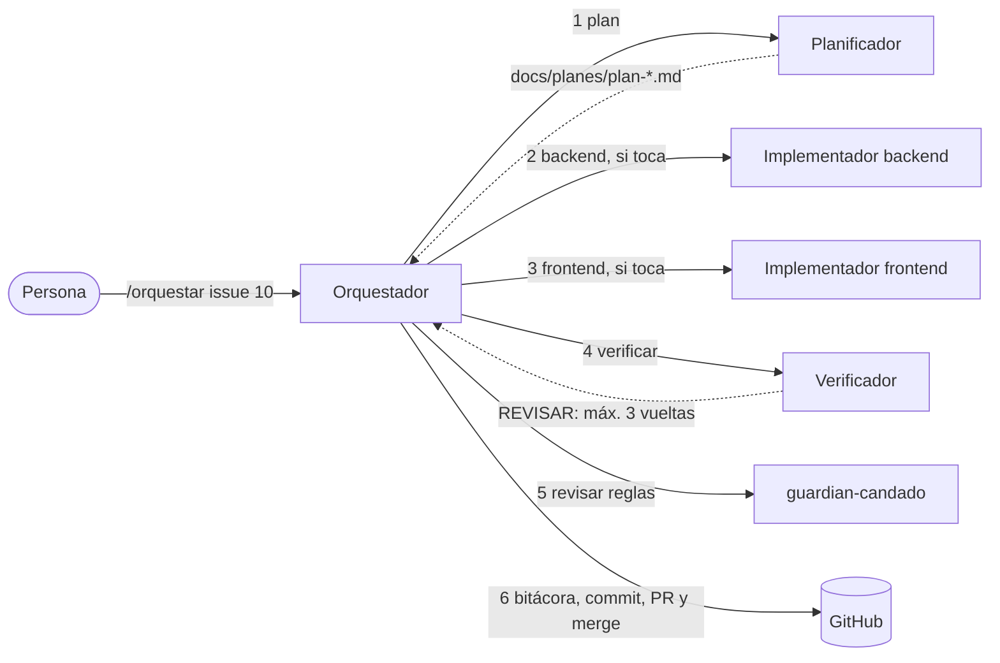

# Lab — El equipo de agentes: orquestador, planificador, implementadores y verificador

> Guion de la clase del 2026-11-26. Duración: unas 2 horas y 15 minutos. Proyecto: DemoAgentes (Lista de Tareas).
> La solución de referencia, con el contenido completo de cada agente, está aparte en [lab-agentes-orquestador-solucion.md](lab-agentes-orquestador-solucion.md). Úsala solo como plan B.

## Objetivo

Al terminar el lab, el grupo habrá creado cinco agentes de Claude Code que trabajan juntos y los habrá visto implementar un issue real de principio a fin, del issue de GitHub a la PR fusionada:



Lo que se aprende:

1. La diferencia entre **skill** (cómo se hace algo), **agente** (quién lo hace y con qué permisos) y **comando** (cómo se lanza).
2. Cómo se escribe un agente: `name`, `description`, `tools`, `model` y unas instrucciones con un formato de salida fijo.
3. Por qué se separan los papeles: **quien verifica no corrige** y **quien coordina no implementa**.
4. Dónde trabaja el orquestador: en la **conversación principal**, para poder pararse a preguntar a la persona en los puntos de control y para que se vea cada paso.
5. Cómo encajan los puntos de control humanos (CRITERIO) en un flujo automático.

## Agenda

| Bloque | Tiempo | Qué se hace |
|---|---|---|
| 0. Preparación | 10 min | Repositorio al día, tests en verde y Claude Code abierto |
| 1. Conceptos | 15 min | Skills, agentes y comandos; lo que ya hay en el repositorio |
| 2. Lab 1: verificador | 15 min | El agente más sencillo: solo lee y ejecuta los tests |
| 3. Lab 2: planificador | 15 min | Convierte un issue en un plan por capas |
| 4. Lab 3: implementadores | 20 min | Backend y frontend, cada uno con sus skills y sus carpetas |
| 5. Lab 4: orquestador | 20 min | El coordinador y su comando `/orquestar` |
| 6. Demo: issue #10 de principio a fin | 30 min | `/orquestar #10` en directo |
| 7. Extensiones y cierre | 10 min | Ideas para seguir y preguntas de repaso |

---

## 0. Preparación (10 min)

Cada persona, en PowerShell, desde la raíz del repositorio:

```powershell
git pull
```

```powershell
.\scripts\backend-setup.ps1
```

```powershell
.\scripts\frontend-setup.ps1
```

```powershell
.\scripts\backend-test.ps1
```

```powershell
.\scripts\frontend-test.ps1
```

```powershell
gh auth status
```

**Comprobación:** los dos scripts de tests terminan con "Todo en verde" (95 tests del backend y 7 del frontend) y `gh` está autenticado. Abre Claude Code en la carpeta del repositorio.

> ⏱️ En el ensayo, los agentes nuevos tardaron **unos 7 minutos** en aparecer en una sesión ya abierta (los comandos aparecen al momento). Si no quieres esperar en cada lab, abre una sesión nueva de Claude Code después de crear cada agente, o crea los ficheros de los cinco agentes al principio y rellénalos lab a lab.

> 💡 Si PHPUnit "se cuelga", es el antivirus analizando `vendor/` (bitácora, paso 31): añade una exclusión para la carpeta del repositorio.

---

## 1. Conceptos (15 min)

### Skill, agente y comando

| | Skill | Agente | Comando |
|---|---|---|---|
| Qué es | Un procedimiento: **cómo** se hace algo | Un especialista: **quién** lo hace, con qué herramientas y límites | Un atajo: **cómo** se lanza algo |
| Dónde vive | `.claude/skills/<nombre>/SKILL.md` | `.claude/agents/<nombre>.md` | `.claude/commands/<nombre>.md` |
| Contexto | El de quien lo usa | **Propio y limpio**: solo ve lo que le pasan | El de la conversación |
| Ejemplo aquí | `modelo`, `api`, `nueva-feature` | `guardian-candado`, `qa-exploratorio` | `/revisar-candado`, `/probar-qa` |

### Lo que ya existe en el repositorio

- **Skills por capa:** `analisis-diseno` → `modelo` → `dto` → `servicio` → `api` → `frontend` → `pruebas`, más `bitacora` y `mensaje-commit`.
- **Skill orquestador `nueva-feature`:** detecta qué capas toca una petición y en qué orden. Hoy los agentes lo van a **usar**.
- **Siete agentes de apoyo** con su comando: `refinador-backlog`, `guardian-candado`, `trazador-reglas`, `qa-exploratorio`, `revisor-seguridad`, `disenador-ui` y `presentador`.

Enséñalo en pantalla:

```
/agents
```

Y abre uno, por ejemplo [.claude/agents/guardian-candado.md](../../.claude/agents/guardian-candado.md), para ver la anatomía de un agente:

```markdown
---
name: guardian-candado            ← cómo se llama (kebab-case)
description: >-                   ← CUÁNDO usarlo: lo lee el agente principal para decidir
  Revisa que un cambio cumple el CLAUDE.md…
tools: Read, Grep, Glob, Bash     ← QUÉ puede hacer (sin Edit ni Write: no puede corregir)
model: sonnet                     ← qué modelo usa
---
Eres el guardián del candado…     ← instrucciones: qué lee, qué hace, reglas y QUÉ DEVUELVE
```

### Tres ideas clave antes de empezar

1. **Permisos mínimos:** cada agente tiene solo las herramientas que necesita. El verificador no tiene `Edit`; el planificador solo escribe en `docs/planes/`.
2. **Salida con formato fijo:** el orquestador tiene que poder leer lo que devuelve cada agente (por ejemplo, `Veredicto: APROBADO` o `REVISAR`).
3. **El orquestador, en la conversación principal:** un subagente puede lanzar a otros (por defecto, hasta tres niveles por debajo de la conversación principal; se ajusta con la variable `CLAUDE_CODE_MAX_SUBAGENT_SPAWN_DEPTH`). Pero un subagente trabaja hasta el final sin hablar con la persona, y el orquestador tiene que parar en los CRITERIO. Por eso lo lanzamos en la conversación principal, con un comando (`/orquestar`) o arrancando Claude Code como ese agente (`claude --agent orquestador`).

---

## 2. Lab 1 — El verificador (15 min)

**Por qué empezamos por aquí:** es el agente más sencillo y el más útil. Solo lee y ejecuta; da un veredicto.

### Especificación

| | |
|---|---|
| Fichero | `.claude/agents/verificador.md` |
| Herramientas | `Read, Grep, Glob, Bash, PowerShell` (sin `Edit` ni `Write`) |
| Modelo | `sonnet` |
| Entrada | El plan (`docs/planes/plan-*.md`) y la rama o el rango a verificar |
| Qué hace | Ejecuta `backend-test.ps1` (y `frontend-test.ps1` si el plan toca el frontend); si hay migraciones, `doctrine:schema:validate`; comprueba que cada criterio de aceptación del plan tiene su test |
| Salida | `Veredicto: APROBADO` o `REVISAR`, con una tabla de defectos: fichero, qué falla, capa responsable (backend o frontend) y cómo reproducirlo |
| Regla de oro | **No corrige nada.** Si algo falla, lo describe para que lo arregle el implementador |

### Pasos

1. Crea el fichero con el frontmatter de la especificación.
2. Escribe las instrucciones con cuatro apartados: **Qué lees**, **Qué ejecutas**, **Reglas** y **Qué devuelves**.
3. Comprueba que aparece en `/agents`. Claude Code vigila `.claude/agents/` y lo detecta sin reiniciar, pero puede tardar varios minutos (unos 7 en el ensayo). Si tienes prisa, abre una sesión nueva. Si tampoco aparece ahí, revisa que `name` y `description` estén bien escritos en el frontmatter.

### Prueba

> Usa el agente verificador para verificar el estado actual de `main`. No hay plan: limítate a los tests.

**Resultado esperado:** `Veredicto: APROBADO`, con 95 tests del backend y 7 del frontend en verde, y ningún fichero modificado (`git status` limpio).

**Pregunta para el grupo:** ¿qué pasaría si le diéramos `Edit` al verificador?

---

## 3. Lab 2 — El planificador (15 min)

### Especificación

| | |
|---|---|
| Fichero | `.claude/agents/planificador.md` |
| Herramientas | `Read, Grep, Glob, Bash, Write, Skill` |
| Modelo | `sonnet` |
| Entrada | Un issue (`#<nº>`) o una petición |
| Qué hace | Usa el skill `nueva-feature` en modo `plan` para detectar el alcance (qué capas toca); lee el análisis y los criterios de aceptación |
| Salida | `docs/planes/plan-<nº>-<slug>.md` con: objetivo, criterios de aceptación, capas afectadas y descartadas (y por qué), pasos por capa con el skill que se usa, ficheros previstos, tests que cubren cada criterio y riesgos |
| Reglas | Solo escribe en `docs/planes/`. No toca código. Si falta una regla de negocio, lo apunta como pregunta abierta y no la inventa |

### Pasos

1. Crea el fichero y sus instrucciones.
2. Define la **plantilla del plan** dentro de las instrucciones, para que todos los planes salgan iguales: el orquestador y el verificador los van a leer.

### Prueba

> Usa el agente planificador para planificar el issue #11 (pantalla de papelera).

**Resultado esperado:** `docs/planes/plan-11-papelera.md` con las **capas afectadas: frontend y pruebas**. El backend queda descartado porque `GET /api/tasks/trash` y `POST /api/tasks/{id}/restore` ya existen. El plan también avisa de la dependencia: el #11 necesita el `TaskApiService` que crea el #10.

**Pregunta para el grupo:** ¿qué ganamos al guardar el plan en un fichero en lugar de dejarlo en la conversación?

> Borra el plan de prueba al terminar (`docs/planes/plan-11-papelera.md`) o guárdalo para la próxima sesión.

---

## 4. Lab 3 — Los implementadores (20 min)

Son dos agentes casi iguales; lo que cambia es **qué carpeta pueden tocar** y **qué skills usan**.

| | Implementador backend | Implementador frontend |
|---|---|---|
| Fichero | `.claude/agents/implementador-backend.md` | `.claude/agents/implementador-frontend.md` |
| Herramientas | `Read, Grep, Glob, Bash, PowerShell, Edit, Write, Skill` | Las mismas |
| Modelo | `inherit` (el de la sesión) | `inherit` |
| Puede editar | `backend/` (código, tests y migraciones) | `frontend/` (código y tests) |
| Skills | `modelo` → `dto` → `servicio` → `api` → `pruebas`, en ese orden y solo los que diga el plan | `frontend` (modo `crear`) y, si existe, la especificación de `docs/diseno/` |
| Entrada | El plan, más la lista de defectos del verificador si es una vuelta de corrección | Lo mismo |
| Salida | Ficheros tocados, skills usados, resultado de los tests de su capa y dudas | Lo mismo |
| No hace | Commits, PR, ni cambios fuera de su carpeta | Lo mismo |

### Pasos

1. Crea los dos ficheros. Escribe primero el del backend y copia y adapta el del frontend: es un buen momento para enseñar que los agentes se pueden reutilizar.
2. Insiste en la regla: "**cada capa con su skill**". El implementador no escribe código "a su manera": carga el skill (herramienta `Skill`) y sigue sus convenciones.
3. Añade el modo **corrección**: si recibe defectos del verificador, solo arregla esos defectos.

### Prueba rápida (sin implementar nada)

> Usa el implementador frontend para decir qué ficheros crearía para el plan del issue #11, sin escribir nada.

**Resultado esperado:** una lista con `core/api/task-api.service.ts` (métodos `trash()` y `restore()`), `features/tasks/task-trash/`, la ruta en `app.routes.ts` y sus tests. Ningún fichero modificado.

---

## 5. Lab 4 — El orquestador (20 min)

### Especificación

| | |
|---|---|
| Fichero del agente | `.claude/agents/orquestador.md` |
| Comando | `.claude/commands/orquestar.md` |
| Herramientas | `Agent, Read, Grep, Glob, Bash, PowerShell, Skill` (sin `Edit` ni `Write`: **coordina, no implementa**) |
| Modelo | `inherit` |
| Entrada | Un issue (`#<nº>`) |
| Salida | La PR fusionada y un resumen final: objetivo, agentes usados, ficheros, tests, veredictos y pendientes |

### El flujo que debe seguir

1. **Preparar:** `gh issue view <nº>`, `main` al día y rama `feature/<nº>-<slug>`. Firmas: solo aviso (CLAUDE.md).
2. **Planificar:** lanza al `planificador`. Lee el plan. Si tiene preguntas abiertas de negocio, **se para y pregunta** (CRITERIO).
3. **Implementar:** lanza al `implementador-backend` si el plan toca el backend y después al `implementador-frontend` si toca el frontend. Nunca en paralelo sobre los mismos ficheros.
4. **Verificar:** lanza al `verificador`. Si dice `REVISAR`, pasa los defectos al implementador de la capa responsable y vuelve a verificar. **Máximo 3 vueltas.** Si no hay `APROBADO`, se para con un informe de bloqueo y no hace commit.
5. **Revisar reglas:** lanza al `guardian-candado` sobre `main..HEAD`. Si dice `NO CUMPLE`, se corrige como en el paso 4.
6. **Cerrar:** bitácora (skill `bitacora`), commit (skill `mensaje-commit`), PR con `Closes #<nº>` y merge con los tests en verde (regla de merge del CLAUDE.md).
7. **Resumen final** para la persona, con la tabla de agentes y veredictos.

### El comando

El comando hace que **la conversación principal** actúe como orquestador. Así lanza a los demás agentes y, a la vez, puede pararse a preguntarte en los CRITERIO:

```markdown
---
description: Orquesta un issue de principio a fin con el equipo de agentes.
argument-hint: '#<nº de issue>'
---
Actúa como el agente orquestador en esta misma conversación: lee y sigue
.claude/agents/orquestador.md. No lo lances como subagente: tiene que poder
preguntarme en los puntos de control. Issue: $ARGUMENTS
```

Alternativa para enseñar: arrancar Claude Code directamente como ese agente (la sesión principal toma sus herramientas y su modelo). También se puede fijar en `.claude/settings.json` con la clave `"agent": "orquestador"`.

```powershell
claude --agent orquestador
```

### Prueba en seco

> /orquestar #11, pero solo hasta el plan: enséñame qué agentes lanzarías y en qué orden, sin implementar.

**Resultado esperado:** lanza al planificador, enseña el plan y la secuencia: `implementador-frontend` → `verificador` → `guardian-candado` → cierre. El backend se omite y lo dice.

---

## 6. Demo — Issue #10 de principio a fin (30 min)

**Por qué el #10:** es un issue real y visible (pantallas de tareas), la API ya existe y tiene una especificación de diseño (`docs/diseno/pantallas-tareas.md`). Además, el orquestador tiene que **descartar el backend**: es la mejor forma de enseñar la detección de alcance.

### Antes de empezar (5 min antes de la clase)

1. `main` al día y tests en verde (bloque 0).
2. Backend con datos de ejemplo, para que la pantalla no salga vacía:

```powershell
.\scripts\backend-start.ps1
```

```powershell
$api = 'http://127.0.0.1:8000/api'
$plantilla = Invoke-RestMethod -Method Post -Uri "$api/task-templates" -ContentType 'application/json' -Body '{"title":"Regar las plantas","recurrence":"weekly"}'
Invoke-RestMethod -Method Post -Uri "$api/task-templates/$($plantilla.id)/instantiate"
$hecha = Invoke-RestMethod -Method Post -Uri "$api/tasks" -ContentType 'application/json' -Body '{"title":"Llamar al taller"}'
Invoke-RestMethod -Method Post -Uri "$api/tasks/$($hecha.id)/complete"
Invoke-RestMethod -Method Post -Uri "$api/tasks" -ContentType 'application/json' -Body '{"title":"Comprar pan"}'
Invoke-RestMethod -Method Post -Uri "$api/tasks" -ContentType 'application/json' -Body '{"title":"Pagar el alquiler","recurrence":"monthly"}'
```

> Los ids se toman de cada respuesta, no se escriben a mano: en `var/data.db` el contador de plantillas ya no empieza en 1 (se probó y se borró una), y `task-templates/1/instantiate` daría un 404 en plena clase. La tarea "Llamar al taller" se completa para que la lista enseñe desde el principio pendientes **y** completadas (primer criterio del issue).

3. Ten abierta la pestaña del repositorio en GitHub (issues y PR).

### Guion en directo

| Minuto | Qué pasa | Qué enseñar y qué decir |
|---|---|---|
| 0 | Escribes `/orquestar #10` | "Yo solo doy la orden de salida. A partir de aquí, cada sombrero lo lleva un agente." |
| 1–4 | El orquestador lee el issue, crea `feature/10-pantallas-tareas` y lanza al planificador | Abre `docs/planes/plan-10-*.md`: capas afectadas (frontend y pruebas) y backend descartado, con el motivo |
| 4–5 | **CRITERIO:** el orquestador enseña el plan | "Aquí podría parar y preguntarme. Este es el punto de control humano." |
| 5–15 | El implementador frontend usa el skill `frontend`: modelos, `TaskApiService`, `task-list`, `task-form`, pipe `recurrenceLabel`, rutas y tests | Enseña que **carga el skill** y que sigue la especificación de diseño. Mientras trabaja, explica por qué no puede tocar `backend/` |
| 15–18 | El verificador ejecuta `frontend-test.ps1` y `backend-test.ps1` | Lee el veredicto. Si sale `REVISAR`, es la mejor parte de la demo: el bucle de corrección en directo |
| 18–20 | El guardián revisa `main..HEAD` | `CUMPLE` / `NO CUMPLE`: "Otro agente, con otro contexto, comprueba que nadie se ha salido del candado." |
| 20–24 | Bitácora, commit, PR con `Closes #10` y merge | Enseña la PR en GitHub y el issue #10 cerrado solo |
| 24–28 | `.\scripts\frontend-start.ps1` y abre <http://localhost:4200/tasks> | Recorre los criterios del issue: lista con pendientes y completadas, formulario con título vacío, completar una repetitiva (aparece la siguiente) y eliminar (pide confirmación del navegador). Para el error de la API, abre `/tasks/999/edit` |
| 28–30 | Resumen final del orquestador | La tabla de agentes y veredictos: "Esto es lo que firmaría una persona." |

### Si algo sale mal (plan B)

| Problema | Qué hacer |
|---|---|
| Un agente no aparece | Puede tardar varios minutos: abre una sesión nueva de Claude Code. Si sigue sin aparecer, revisa el frontmatter (`name`, `description`) |
| `git switch -c feature/10-…` falla porque la rama ya existe | Quedó de un intento anterior: `git branch -D feature/10-pantallas-tareas` |
| El orquestador intenta implementar él mismo | Revisa que no tenga `Edit` ni `Write`. Es un buen momento para explicar por qué los permisos importan |
| El orquestador no se para a preguntar en el plan | Se ha lanzado como subagente: usa el comando `/orquestar` o `claude --agent orquestador` |
| El verificador da `REVISAR` 3 veces | Es el comportamiento correcto: enseña el informe de bloqueo y explica que no hay commit automático |
| Se acaba el tiempo | Para después del verificador; enseña el plan, el diff (`git diff --stat main`) y el veredicto. El cierre se hace al día siguiente |
| Hay que volver a empezar | `git switch main`, `git branch -D feature/10-pantallas-tareas` y borra el plan de `docs/planes/` |
| No da tiempo a crear los agentes | Copia los de [la solución de referencia](lab-agentes-orquestador-solucion.md) en `.claude/agents/` y `.claude/commands/` |

## Ensayo del 2026-11-26

La demo se ensayó en ramas locales (`ensayo/lab-orquestador` con los agentes y `ensayo/10-pantallas-tareas` con el resultado), sin push, sin PR y sin tocar el issue #10, que sigue abierto para la clase. El backend usó una base de datos propia (`var/ensayo.db`).

| Paso | Agente | Tiempo | Resultado |
|---|---|---|---|
| Plan | planificador | 40 s | `docs/planes/plan-10-pantallas-tareas.md`; backend descartado con su motivo, sin preguntas de negocio |
| Implementar | implementador-frontend | 5,5 min | `TaskApiService`, pipe, `task-list`, `task-form` y rutas; 42 tests de Vitest y build en verde a la primera |
| Verificar | verificador | 40 s | `APROBADO` en la primera vuelta (91 + 42 tests; los 5 criterios con su test) |
| Revisar reglas | guardian-candado | 25 s | `CUMPLE`; solo notas: commit, bitácora y PR pendientes del cierre |
| Pantallas | (a mano) | 3 min | Lista, completar una repetitiva, título vacío y eliminar, sin errores de consola |

En total, unos **7 minutos de agentes** (435 s): sobra tiempo en el bloque de 30 minutos para comentar cada paso.

**Lo que se corrigió después del ensayo:**

1. **Los agentes nuevos tardaron unos 7 minutos en aparecer** en la sesión (el comando `/orquestar`, en cambio, apareció al momento). Por eso el bloque 0 pide crear o copiar los agentes al principio, y el plan B dice que se abra una sesión nueva si no aparecen.
2. **Los ids de los datos de ejemplo** estaban escritos a mano y el de la plantilla daba 404 con la base de datos de desarrollo. Ahora se toman de cada respuesta.
3. **El verificador y el guardián miraban `main..HEAD`**, pero el commit llega al final del flujo: habrían revisado un diff vacío. Ahora miran también los cambios sin commit.
4. **El planificador inventó un agente** (`implementador-pruebas`) para los tests. Ahora solo puede asignar los agentes que existen, y los tests los escribe el implementador de cada capa.
5. **Los skills `frontend` y `nueva-feature` terminan con bitácora, commit y PR**, lo que choca con los agentes que no hacen commits. Las instrucciones de cada agente dicen ahora que el cierre es del orquestador.

### Segundo ensayo: `/orquestar #23` con el backend

Para cubrir lo que el primero no probó, se repitió con los agentes ya corregidos, creados **sin commit** en `.claude/agents/` (como en clase), `/orquestar` lanzado **como comando** y un issue de backend real: el [#23](https://github.com/hispafox/DemoAgentes/issues/23), errores en `problem+json` para rutas de la API que no existen. Esta vez sí acabó en PR fusionada ([#24](https://github.com/hispafox/DemoAgentes/pull/24)).

| Agente | Tiempo | Resultado |
|---|---|---|
| planificador | 30 s | Capa `api` y pruebas; frontend descartado |
| implementador-backend | 2,5 min | Cargó `analisis-diseno`, `api` y `pruebas`; 95 tests en verde |
| verificador | 20 s | `APROBADO` a la primera |
| guardian-candado | 25 s | `CUMPLE` |

Lo que salió y se corrigió: **nadie en el equipo podía actualizar el análisis** (el planificador solo escribe planes, el orquestador no edita y el implementador solo tocaba su carpeta). Ahora los implementadores pueden tocar `docs/analisis.md` con el skill `analisis-diseno` cuando el plan lo pide. También se corrigió el skill `api`, que decía que no hacía falta un *listener*.

### Planes B

| Si en clase… | Plan B | Dónde |
|---|---|---|
| …no da tiempo a escribir los agentes, o salen mal | Copiar los cinco agentes y el comando ya revisados | [`docs/formacion/agentes-referencia/`](agentes-referencia/README.md), con dos `Copy-Item` |
| …se quiere leer o comentar el contenido de un agente | La solución en texto, bloque a bloque | [lab-agentes-orquestador-solucion.md](lab-agentes-orquestador-solucion.md) |
| …la demo `/orquestar #10` falla en directo o se acaba el tiempo | Enseñar las pantallas que ya hicieron los agentes en el primer ensayo | Rama `ensayo/10-pantallas-tareas`: `git diff --stat main ensayo/10-pantallas-tareas` y `git switch ensayo/10-pantallas-tareas` |
| …se quiere enseñar cómo eran los agentes antes de corregirlos | La primera versión, tal como se ensayó | Rama `ensayo/lab-orquestador` (no se fusiona) |

---

## 7. Extensiones y cierre (10 min)

### Ideas para seguir (deberes o próxima sesión)

1. **QA en el bucle:** añade `qa-exploratorio` después del verificador cuando el plan toque el backend.
2. **Diseño previo:** que el orquestador lance `disenador-ui` antes del implementador frontend si no hay especificación en `docs/diseno/`.
3. **Generador de tests:** un agente que solo escribe tests a partir de los criterios, antes de implementar (TDD con agentes).
4. **Probar a los agentes:** el `evaluador-agentes` de `docs/propuesta-agentes.md`, que lanza a cada agente con escenarios fijos y puntúa sus respuestas.
5. **Paralelo de verdad:** backend y frontend a la vez, cada uno en su worktree, cuando el contrato de la API está cerrado.

### Preguntas de repaso

1. ¿Por qué el orquestador no tiene `Edit`?
2. ¿Qué pasa si el verificador corrigiera lo que encuentra?
3. Un subagente puede lanzar a otros. Entonces, ¿por qué el orquestador trabaja en la conversación principal?
4. ¿Dónde están los puntos de control humanos en este flujo?
5. ¿Qué diferencia hay entre el skill `nueva-feature` y el agente orquestador?
6. Si mañana añadimos categorías (#15), ¿qué agentes trabajarán y cuáles se descartarán?

### Checklist de evaluación del lab

- [ ] Los cinco agentes aparecen en `/agents`.
- [ ] El verificador da `APROBADO` sobre `main` sin modificar ningún fichero.
- [ ] El planificador genera un plan con capas afectadas y descartadas.
- [ ] Los implementadores solo tocan su carpeta.
- [ ] `/orquestar` lanza a los agentes en el orden correcto y respeta el máximo de 3 vueltas.
- [ ] La PR del issue lleva `Closes #<nº>`, los tests en verde y la bitácora actualizada.
