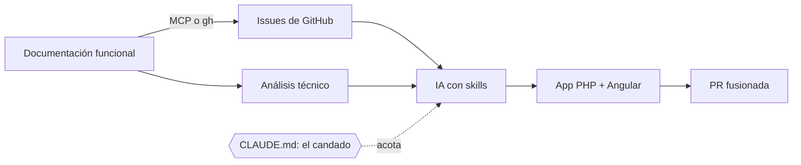
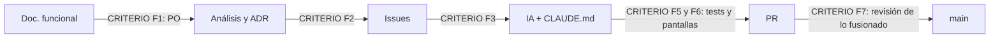
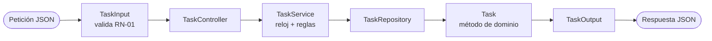
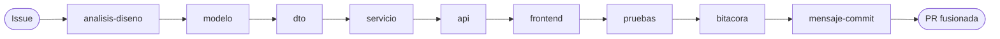

# Clase del 2026-11-26 (versión extendida): de la pizarra a un equipo de agentes

**Mensaje principal:** con un `CLAUDE.md` que cierra el marco, skills por capa, agentes con permisos mínimos y puntos de control humanos, una IA lleva una app de la documentación funcional a una PR fusionada. Lo difícil no es el código: son las costuras entre piezas, y por eso se ensaya.

**Duración estimada:** unos 55 minutos con la demo en vivo (unos 50 sin ella). 40 diapositivas en 12 secciones; cada sección empieza con una diapositiva separadora de 15 a 20 segundos. Después viene el lab (`docs/formacion/lab-agentes-orquestador.md`), que no se repite aquí.

| Sección | Diapositivas | Minutos |
|---|---|---|
| 1. El proyecto y la idea | 1 a 2 | 2,5 |
| 2. El candado, las firmas y el CRITERIO | 3 a 5 | 4,5 |
| 3. De la documentación al backlog y al análisis | 6 a 8 | 4,5 |
| 4. El backend por capas | 9 a 13 | 8 |
| 5. Calidad y tests | 14 a 15 | 2 |
| 6. Skills | 16 a 18 | 4 |
| 7. Agentes de apoyo (con la demo corta) | 19 a 26 | 12 |
| 8. Skill, agente y comando | 27 a 29 | 4 |
| 9. El equipo del lab y el orquestador | 30 a 31 | 2,5 |
| 10. Los dos ensayos | 32 a 34 | 4,5 |
| 11. Lo que salió mal | 35 a 37 | 3,5 |
| 12. Planes B, lo que queda y el paso al lab | 38 a 40 | 3,5 |

**Fuentes:** `docs/bitacora.md` (pasos 1 a 65), `CLAUDE.md`, `README.md`, `docs/app/lista-de-tareas.md`, `docs/analisis.md`, `docs/decisiones/`, `docs/formacion/` (lab, solución y `agentes-referencia/`), `docs/planes/`, `docs/propuesta-agentes.md`, `docs/propuesta-skills.md`, `.claude/agents/`, `.claude/skills/` (solo los del proyecto), `backend/src`, `backend/tests`, `frontend/src` y GitHub (`gh issue list --state all`, `gh pr list --state all`), consultados el 2026-11-26. Los skills `docx`, `pdf`, `pptx` y `xlsx` de `.claude/skills/` son de Anthropic, con licencia restrictiva: no se citan.

**Cómo leer cada diapositiva:** título (una línea), de 3 a 5 puntos, el elemento visual (`Visual: …`) y las notas del orador. En las separadoras, solo una frase y qué se va a ver.

---

# Sección 1. El proyecto y la idea

## Diapositiva 1. Separadora: el proyecto y la idea

- Una demo de desarrollo asistido por agentes de IA.
- Empezó el 2026-11-24 con un dibujo en una pizarra.
- Esta sección: qué construimos y con qué idea.

Visual: ninguno; fondo de sección con el número 1 y el título "El proyecto y la idea".

**Notas del orador:** abre con una frase: "hace dos días esto era una pizarra" (el paso 1 es del 2026-11-24). No te detengas: 15 segundos.

## Diapositiva 2. De la pizarra a la Pull Request

- La documentación de la app se convierte, vía MCP o `gh`, en issues y en un análisis técnico.
- La IA implementa cada issue dentro del marco del `CLAUDE.md` (el candado).
- Cada issue acaba en una rama y una PR con `Closes #<nº>`.
- La app: una Lista de Tareas con plantillas, tareas repetitivas y papelera.
- Stack: PHP 8.3 con Symfony 7 y Doctrine, SQLite (ADR-0003) y Angular 22 con Vitest.

Visual: diagrama — `Documentación → Issues de GitHub → IA con skills → App PHP + Angular → PR fusionada`, con `Análisis` entrando en la IA y `CLAUDE.md` (candado) acotándola.



**Notas del orador:** es la pizarra del paso 1 pasada a limpio. En la pizarra original el backlog iba a Jira; en el paso 7 se cambió a GitHub (épica = milestone, ticket = issue, `Closes #12` cierra solo). El MCP de GitHub se sustituyó por la CLI `gh` (paso 59). Aclara que es una demo didáctica: se prioriza la claridad del código sobre la sofisticación. Enseña el repositorio en GitHub. Tiempo: 2 minutos.

---

# Sección 2. El candado, las firmas y el CRITERIO

## Diapositiva 3. Separadora: el candado

- Quién pone el marco en el que trabaja la IA.
- Qué es una firma y por qué hoy solo avisa.
- Dónde para el flujo para que decida una persona.

Visual: ninguno; fondo de sección con el número 2.

**Notas del orador:** 15 segundos. Anuncia que esta es la sección de "gobierno": todo lo demás depende de ella.

## Diapositiva 4. El candado: el CLAUDE.md

- Un solo fichero fija stack, capas, convenciones de API y reglas del agente.
- Si algo no encaja, se cambia primero el candado, con aprobación, y no el código por libre.
- Una firma la da una persona en el chat ("apruebo", "lo firmo"); el agente nunca firma por su cuenta.
- Firmas en modo aviso (decisión del 2026-11-25): una firma pendiente se avisa en una línea y no bloquea la clase.
- Siguen siendo obligatorios: issue para implementar, y tests en verde para abrir PR y fusionar.

Visual: código — extracto de `CLAUDE.md`, sección "Reglas para el agente":

```
- Este CLAUDE.md es el candado: ninguna implementación puede salirse de lo que define.
- Firmas en modo aviso: si falta una firma, avisar en una línea y seguir (sección "Firmas"). Una firma solo la da una persona en el chat; el agente nunca firma por su cuenta.
- No implementar nada sin issue de GitHub asociado.
- No abrir PR si los tests no pasan.
- Merge de las PR: como es una demo de clase, el agente hace el merge de cada PR en cuanto los tests están en verde, sin esperar aprobación, y no deja PR abiertas (decisión de hispafox, 2026-11-25). Nunca con tests en rojo.
- Respetar el análisis de `docs/analisis.md`; si hay que desviarse, proponer un ADR antes.
```

**Notas del orador:** en la pizarra, el candado ① no eran "los tests en verde": era el diseño (paso 3, donde se corrigió la interpretación). Enseña `CLAUDE.md` abierto. Cuenta que una firma deja tres huellas que deben coincidir: una fila en el Registro de firmas, la cabecera del documento y el `[x]` del CRITERIO. Hoy hay 9 filas en "Pendientes de firma". Mensaje: un control que se relaja debe dejar rastro; aquí lo deja esa tabla. Pregunta al grupo: "¿un control que bloquea o uno que avisa?" y cuenta por qué aquí se eligió avisar (formación, pasos 24 y 56). En un proyecto real el merge lo revisaría una persona antes de fusionar (paso 47). Tiempo: 2 minutos.

## Diapositiva 5. El flujo con puntos de CRITERIO

- Documentación funcional → issues y análisis → código → PR.
- En cada salida hay un CRITERIO: revisión humana antes de avanzar.
- Cada fase exige firmados sus entregables de entrada (en modo aviso).
- Ejemplo real: el `405` entró en el candado con la aprobación expresa de hispafox (pasos 62 a 64).
- Los CRITERIO de las fases 3, 5 y 6 siguen sin cerrar: son firmas y solo las da una persona.

Visual: diagrama — `DOC → [CRITERIO Fase 1] → ANÁLISIS → [CRITERIO Fase 2] → ISSUES → [CRITERIO Fase 3] → IA dentro del CLAUDE.md → [CRITERIO Fase 5 y 6] → PR → [CRITERIO Fase 7]`.



**Notas del orador:** enseña la tabla "Para hacer… / Debe estar firmado" del `CLAUDE.md` (análisis requiere doc. funcional; backlog requiere candado, doc. y análisis; implementar requiere backlog y ADR; abrir PR requiere tests en verde). Cuenta la historia corta: el 2026-11-24 la regla bloqueaba (paso 21) y bloqueó el backlog; ese mismo día se suspendió (paso 24) y el 2026-11-25 pasó a modo aviso permanente (paso 56). Tiempo: 2 minutos.

---

# Sección 3. De la documentación al backlog y al análisis

## Diapositiva 6. Separadora: del documento al issue

- Qué dice la app (funcionalidades y reglas).
- Cómo se diseña (análisis y ADR).
- Cómo se convierte en trabajo (issues con criterios).

Visual: ninguno; fondo de sección con el número 3.

**Notas del orador:** 15 segundos. Idea: cada cosa tiene su identificador, y de ese identificador se tira del hilo hasta el test.

## Diapositiva 7. Documentación, análisis y ADR: F-xx, RN-xx

- La documentación funcional define el qué: 19 funcionalidades (F-01 a F-19) y 18 reglas de negocio (RN-01 a RN-18).
- El análisis define el cómo: entidades, endpoints, lógica, pantallas y plan de tests, con trazabilidad F-xx y RN-xx.
- Tres ADR: PostgreSQL (0001), código y API en inglés (0002) y SQLite en la 0.1 (0003).
- Las dudas se resuelven con el PO y quedan escritas: 10 preguntas con respuesta (RN-12, RN-17, RN-18…).
- La versión 0.2 (categorías, F-15 a F-19) se añadió después y el documento perdió la firma.

Visual: tabla — filas y columnas exactas:

| Documento | Qué define | Ejemplo real |
|---|---|---|
| `docs/app/lista-de-tareas.md` | Funcionalidades y reglas, sin tecnología | RN-05: al completar una tarea repetitiva se genera una nueva ocurrencia, desde el día en que se completa |
| `docs/analisis.md` | Entidades, 14 endpoints, lógica, pantallas y tests | `GET /api/tasks/trash`, `POST /api/task-templates/{id}/instantiate` |
| `docs/decisiones/` | Una decisión técnica por fichero | ADR-0003: SQLite en la 0.1, porque no hay Docker |

**Notas del orador:** enseña un fragmento del documento funcional (la tabla de reglas) y después la sección 4 del análisis. Cuenta la pregunta del PO sobre el borrado de plantillas: respuesta "no se puede eliminar una plantilla con tareas" y de ahí salen RN-12 y un `409` (paso 18). Cuenta también RN-18 (paso 38): el análisis no decía qué fecha lleva una tarea repetitiva creada a mano, el skill `analisis-diseno` lo detectó con `revisar` y el PO decidió "hoy + periodicidad". Si preguntan por las firmas: las de doc. funcional, análisis y ADR 0001 a 0003 están dadas (2026-11-24) y los cambios posteriores quedan en "pendientes". Tiempo: 2 minutos.

## Diapositiva 8. Del backlog al issue: Dado, Cuando, Entonces

- 14 issues en 4 milestones: Infraestructura, Bloque A (Tareas), Bloque B (Plantillas) y Bloque C (Categorías).
- Cada issue lleva objetivo, enlace al análisis, criterios Dado/Cuando/Entonces y una checklist.
- Un criterio de aceptación = al menos un test (Fase 5).
- Etiquetas: `backend`, `frontend`, `test`, `docs`, `ci`, `historia`, `v0.1` y `v0.2`.
- Lo cierra la PR con `Closes #<nº>`: no se cierra a mano.

Visual: código — criterios de aceptación del issue #6 (`gh issue view 6`):

```
- **Dado** una tarea pendiente no repetitiva, **cuando** hago `POST /api/tasks/{id}/complete`, **entonces** queda completada y `nextOccurrence` es `null` (RN-06).
- **Dado** una tarea pendiente semanal, **cuando** la completo hoy, **entonces** se crea una tarea pendiente con el mismo título y periodicidad y `nextOccurrenceDate` = hoy + 7 días (RN-05).
- **Dado** una tarea mensual completada el 31 de enero, **entonces** la siguiente ocurrencia es el último día de febrero.
- **Dado** una tarea ya completada, **cuando** intento completarla, **entonces** recibo `409` (RN-11).
```

**Notas del orador:** enseña la lista de issues en GitHub (`gh issue list --state all`). El #6 se implementó el 2026-11-25 (paso 48) y esos cuatro criterios se convirtieron en tests: dos de entidad, cuatro de servicio y cinco funcionales. El caso del 31 de enero lo prueba `RecurrenceCalculatorTest`. Las firmas del backlog siguen pendientes. El tablero de GitHub Projects no se pudo crear porque al token le falta el permiso `project` (paso 25). Tiempo: 2 minutos.

---

# Sección 4. El backend por capas

## Diapositiva 9. Separadora: el backend por capas

- Cuatro capas y un DTO.
- Un formato de error único.
- Un arreglo real de principio a fin: el issue #23.

Visual: ninguno; fondo de sección con el número 4.

**Notas del orador:** 15 segundos. Anuncia que se usará el #23 como ejemplo corto que cabe en una pantalla.

## Diapositiva 10. Las capas del backend y el DTO

- `Controller → Service → Repository → Entity`, con `Dto/` para la entrada y la salida.
- El controlador recibe el DTO (`#[MapRequestPayload]`), llama al servicio y devuelve un DTO de salida; nunca serializa entidades.
- Las reglas de negocio viven en los servicios y en los métodos de dominio de las entidades.
- Fechas con `DateTimeImmutable` y `ClockInterface`; así los tests fijan "hoy".
- Mapeo de Doctrine con atributos PHP en la propia entidad; sin XML ni YAML.

Visual: diagrama — `Petición JSON → TaskInput (validación) → TaskController → TaskService → TaskRepository → Task (Doctrine) → TaskOutput → respuesta JSON`.



**Notas del orador:** abre `backend/src/Controller/TaskController.php` y enseña `create()`: recibe `#[MapRequestPayload] TaskInput`, llama a `taskService->create()` y responde `201` con `Location`. Después `TaskInput`: `NotBlank(normalizer: 'trim')` y `Length(max: 255)` con el comentario `// RN-01`. Por último `Task::complete()`: lanza `DomainRuleViolation('RN-11: …')` si ya estaba completada, y el `framework.yaml` convierte esa excepción en `409`: el dominio no sabe nada de HTTP. Hay 8 rutas de `/api/tasks` y 6 de `/api/task-templates`. Las carpetas `Entity/Exception`, `Service/Exception` y `EventListener/` completan el árbol. Tiempo: 2 minutos.

## Diapositiva 11. problem+json: un solo formato de error

- Todos los errores salen en `application/problem+json` (RFC 9457).
- `400` JSON mal formado, `404`, `405` (con `Allow`), `409` estado no permite la acción, `422` validación.
- Las excepciones de dominio se mapean a códigos en `framework.yaml`: `ResourceNotFound` a 404 y `DomainRuleViolation` a 409.
- Truco de Symfony: se lista `application/problem+json` el primero en `framework.request.formats` (paso 44).
- Cada controlador lleva `format: 'json'` para que los errores salgan en JSON aunque no llegue `Accept`.

Visual: código — respuesta `problem+json` de un `422` (`docs/analisis.md` §4, "Formato de errores"):

```json
{ "type": "https://symfony.com/errors/validation", "title": "Validation Failed", "status": 422,
  "detail": "title: This value should not be blank.",
  "violations": [ { "propertyPath": "title", "title": "This value should not be blank." } ] }
```

**Notas del orador:** el formato de error se dejó para el issue #5: en el issue #2 un test de humo exigía la cabecera y Symfony devolvía `application/json` (paso 30). Primero se pensó en un *listener* (paso 41); se resolvió con configuración (paso 44) y por eso el skill `api` se corrigió (paso 45). Esa historia vuelve en la diapositiva siguiente: el skill acabó necesitando el *listener* para otro caso. Mensaje: el frontend tiene un interceptor que traduce este JSON a mensajes en castellano; un formato único hace que el cliente sea sencillo. Tiempo: 1,5 minutos.

## Diapositiva 12. El #23: el arreglo, un subscriber

- El fallo lo encontró el agente `qa-exploratorio` (paso 56): sin cabecera `Accept`, los 404 y 405 de rutas de `/api` que no existen salían en HTML.
- Causa: `format: 'json'` solo vale cuando la ruta coincide; si falla el router, ya es tarde.
- Arreglo: `ApiJsonFormatSubscriber` fija `_format=json` para `/api` antes del router.
- Debe ir antes del `RouterListener` (prioridad 32): por eso la prioridad es 33.
- Fuera de `/api` no cambia nada.

Visual: código — `backend/src/EventListener/ApiJsonFormatSubscriber.php`:

```php
    // Must run before Symfony's RouterListener (priority 32), which throws
    // the 404/405 exceptions for unmatched routes.
    private const PRIORITY = 33;

    public static function getSubscribedEvents(): array
    {
        return [
            KernelEvents::REQUEST => ['onKernelRequest', self::PRIORITY],
        ];
    }
```

**Notas del orador:** enseña el fichero completo; el cuerpo de `onKernelRequest` son cuatro líneas (`'/api' === $path || str_starts_with($path, '/api/')` y `_format` a `json`). Enseña la PR #24 en GitHub y el diff pequeño: un fichero nuevo, 4 tests nuevos y el análisis actualizado. Cuenta el orden de los hechos: el QA lo descubrió, se abrió el issue #23, el planificador pensó el plan en 30 segundos y el implementador lo hizo en 2,5 minutos (paso 62). Detalle de oficio: el skill `api` decía "no hace falta un listener" y aquí sí hacía falta; se corrigió en el skill. Tiempo: 2 minutos.

## Diapositiva 13. El #23: un test por criterio de aceptación

- Cuatro criterios, cuatro tests nuevos en `ApiErrorFormatTest`.
- Ruta inexistente sin `Accept`: `404` en `problem+json`.
- `GET /api/tasks/abc`: `404` aunque el cliente prefiera HTML.
- `PATCH /api/tasks/1`: `405` y se conserva la cabecera `Allow`.
- Una ruta fuera de `/api` no cambia (`GET /`).

Visual: código — `backend/tests/Functional/ApiErrorFormatTest.php` (el criterio 3):

```php
    // CA 3 (#23): PATCH /api/tasks/1 -> 405 problem+json, keeping the Allow header
    public function testMethodNotAllowedReturnsProblemJson405(): void
    {
        $client = self::createClient();

        $client->request('PATCH', '/api/tasks/1', server: ['HTTP_ACCEPT' => '']);

        self::assertResponseStatusCodeSame(405);
        self::assertResponseHeaderSame('Content-Type', 'application/problem+json');
        self::assertSame(405, $this->decodeBody($client)['status']);
```

**Notas del orador:** el plan (`docs/planes/plan-23-errores-problem-json.md`) lista los cuatro criterios con su test previsto, y el implementador los escribió con ese mismo nombre. Enseña la tabla "Tests previstos" del plan. Mensaje: el criterio se convierte en test y el test queda como red. Si quieres, ejecuta en vivo `php bin/phpunit --filter ApiErrorFormatTest` desde `backend/` (1 segundo; el 95 de tests sale de aquí). Tiempo: 2 minutos.

---

# Sección 5. Calidad y tests

## Diapositiva 14. Separadora: calidad y tests

- Qué se comprueba antes de abrir una PR.
- Cuánto cubren los tests.
- Y por qué un solo script lo hace todo.

Visual: ninguno; fondo de sección con el número 5.

**Notas del orador:** 15 segundos.

## Diapositiva 15. Calidad y tests en cifras

- Un solo script, `backend-test.ps1`, ejecuta contenedor, mapeo de Doctrine, PHP-CS-Fixer, PHPStan (nivel 6) y PHPUnit.
- PHPUnit con SQLite de test y DAMA, que deshace cada test: suites `Unit` y `Functional`.
- Vitest en Angular 22: `frontend-test.ps1` ejecuta los tests y el build.
- PHPStan encontró una aserción redundante y PHP-CS-Fixer un PHPDoc mal alineado, ya corregidos (paso 52).
- La CI de GitHub Actions está preparada y aparcada (`.github/ci-pendiente.yml`): falta el permiso `workflow`.

Visual: cifras — `95` tests de PHPUnit · `267` aserciones · `7` tests de Vitest en `main` (`42` en la rama del primer ensayo) · `1` script que lo comprueba todo.

**Notas del orador:** las cifras las comprobé hoy ejecutando `php bin/phpunit` en `backend/`: "OK (95 tests, 267 assertions)", en menos de un segundo. El 7 sale de `app.spec.ts` (2) y `error.interceptor.spec.ts` (5); los 42 son del ensayo, en la rama `ensayo/10-pantallas-tareas`, no fusionada. Cuenta la anécdota del paso 31 y 42: PHPUnit "se colgaba", y la causa no era el código: el disco al 99 % con Microsoft Defender escaneando más de 5.600 ficheros de `vendor/`. Se resolvió con una exclusión de la carpeta del repositorio. Tiempo: 2 minutos.

---

# Sección 6. Skills

## Diapositiva 16. Separadora: los skills

- Un procedimiento por capa.
- Un orquestador de skills.
- Por qué cada skill sabe dónde parar.

Visual: ninguno; fondo de sección con el número 6.

**Notas del orador:** 15 segundos. Recuerda que hay 11 skills de proyecto (no cuentes los `docx`, `pdf`, `pptx` y `xlsx`).

## Diapositiva 17. Anatomía de un SKILL.md

- Una carpeta por skill: `.claude/skills/<nombre>/SKILL.md`.
- El `description` del frontmatter decide cuándo se carga: es lo que lee el agente principal.
- Cuerpo con modos (`crear`, `actualizar`, `revisar`) y una tabla Lee / Escribe / No toca / Prerrequisito / Verificación / Entregable.
- Cada skill cubre un tramo de capas y no inventa contratos ni reglas: la fuente es el análisis.
- Para YAML: `description: >-` en bloque plegado, porque un «: » dentro del texto sin comillas rompe el parser.

Visual: código — cabecera de `.claude/skills/mensaje-commit/SKILL.md`:

```
---
name: mensaje-commit
description: >-
  Redacta el mensaje de commit de DemoAgentes a partir de los cambios preparados.
  Úsalo siempre que se vaya a hacer un commit en este proyecto o cuando el usuario
  pida "mensaje de commit", "commitea", "haz commit" o similar. Produce una primera
  línea "tipo: descripción corta" específica y, si el cambio no es trivial, un
  cuerpo con el detalle.
---
```

**Notas del orador:** este fue el primer skill (paso 6) y el primer error (paso 9): Claude Code mostraba "Nested mappings are not allowed in compact mappings", porque `"tipo: descripción corta"` sin bloque YAML se leía como una clave nueva. La solución: `>-`. Desde entonces, el `description` va en bloque plegado. Enseña también la tabla "Lugar en la orquestación" de `.claude/skills/modelo/SKILL.md`. Tiempo: 2 minutos.

## Diapositiva 18. La cadena por capas y nueva-feature

- Cadena: `analisis-diseno` → `modelo` → `dto` → `servicio` → `api` → `frontend` → `pruebas`, más `bitacora` y `mensaje-commit`.
- `nueva-feature` es el orquestador de skills: detecta qué capas toca una petición y las encadena. No implementa nada.
- Siete pasos: entender, detectar alcance, presentar el plan (punto de control), preparar, ejecutar, verificar (máximo 3 intentos) y cerrar.
- Reglas de propagación: campo nuevo en entidad → DTO de salida → modelo de Angular.
- Los skills de capa se crean justo antes de necesitarlos y se prueban enseguida con un issue real.

Visual: diagrama — `petición o issue → analisis-diseno → modelo → dto → servicio → api → frontend → pruebas → bitacora → mensaje-commit → PR`, con el recuadro `nueva-feature` abarcando toda la cadena.



**Notas del orador:** muestra la tabla "capa → skill → se activa si…" de `nueva-feature`. Pruebas reales con la cadena: issues #5 a #9 (pasos 41 a 51), uno por PR; el #6 pasó por `modelo → dto → servicio → api → pruebas`. Regla de oro: este skill no escribe código "para ir más rápido"; si una capa necesita cambios, carga el skill de su capa. Esta idea se vuelve en el lab: lo usan los agentes. Tiempo: 2 minutos.

---

# Sección 7. Agentes de apoyo

## Diapositiva 19. Separadora: siete agentes de apoyo

- Cada uno con su comando.
- Probados sin tocar el código (paso 56).
- Una diapositiva por agente: quién es y qué encontró.

Visual: ninguno; fondo de sección con el número 7 y los siete nombres.

**Notas del orador:** abre la carpeta `.claude/agents/` y la de `.claude/commands/`: 7 ficheros en cada una. Cuenta que primero se probaron con subagentes genéricos que leían el fichero de cada agente, porque la sesión carga los agentes al arrancar. 15 segundos.

## Diapositiva 20. refinador-backlog: el PO con ayuda

- Comando: `/refinar-backlog`. Herramientas: `Read, Grep, Glob, Bash` (no puede crear nada).
- Lee la documentación funcional y el análisis, y propone issues con criterios Dado/Cuando/Entonces.
- No crea issues sin aprobación expresa: devuelve el borrador y preguntas cerradas para el PO.
- Resultado real: el issue #15 (categorías) no estaba listo para implementar.
- Devolvió 9 preguntas para el PO y 2 borradores (backend y frontend).

Visual: diagrama — `docs/app + analisis → refinador-backlog → borrador de issues + preguntas al PO (sin crear nada)`.

**Notas del orador:** este agente cubre el paso DOC → ISSUES. Cuenta cómo se ajustó tras la prueba: puede marcar con `(pregunta N)` los criterios que dependen de una pregunta sin responder, y la línea final cita solo las preguntas que bloquean. Subraya que es un asistente del PO: la decisión es humana. Tiempo: 1,5 minutos.

## Diapositiva 21. guardian-candado: CUMPLE o NO CUMPLE

- Comando: `/revisar-candado #<PR>`. Herramientas: `Read, Grep, Glob, Bash`; sin `Edit` ni `Write`, no puede corregir.
- Comprueba un diff contra 15 reglas del `CLAUDE.md`: issue, capas, DTO, fechas, API, problem+json, nombres, tests, bitácora, PR…
- Cada hallazgo con fichero y línea; las firmas siempre son aviso, nunca bloqueo.
- En la PR #22 (frontend base): `CUMPLE` con un aviso, la fila de firmas del cambio de stack, ya añadida.
- En los dos ensayos: `CUMPLE` en 25 segundos (#10 y #23).

Visual: tabla — filas y columnas exactas:

| Veredicto | Cuándo | Dónde se vio |
|---|---|---|
| `CUMPLE` con un aviso | Falta la fila de firmas del cambio de stack | PR #22 (paso 56) |
| `CUMPLE` | Sin hallazgos bloqueantes | Primer ensayo, #10 (25 s) |
| `CUMPLE` | Sin hallazgos bloqueantes | Segundo ensayo, #23 y PR #24 (25 s) |

**Notas del orador:** aquí va la demo en vivo (ver el bloque "Demo en vivo" al final): `/revisar-candado #24`. Mientras el agente trabaja (unos 25 segundos en el ensayo), abre `docs/planes/plan-23-errores-problem-json.md` y enseña las capas afectadas y las descartadas. Al terminar, enseña que `git status` sigue limpio: quien verifica no corrige. Tiempo: 2,5 minutos con la demo, 1,5 sin ella.

## Diapositiva 22. trazador-reglas: la matriz de cobertura

- Comando: `/trazar-reglas RN-12`. Solo lee.
- Construye la matriz RN-xx y F-xx → análisis → issue → código → test.
- Señala reglas sin implementar, sin test o con tests que no las nombran.
- Resultado real: RN-01 a RN-13 y RN-18 cubiertas en el backend; el frontend, pendiente (#10 a #12).
- Huecos que encontró: RN-18 no la cita ningún issue, y `GET /api/tasks/trash` no tenía test propio.

Visual: tabla — filas y columnas exactas:

| Regla | Documento | Análisis | Issue | Código | Test |
|---|---|---|---|---|---|
| RN-12 (no borrar plantilla con tareas) | `docs/app/lista-de-tareas.md` | §4 y §5 | #8 | `TaskTemplateService::delete()` | Funcional: `409`, también con tareas en la papelera |

**Notas del orador:** en el paso 56 se lanzó `/trazar-reglas RN-12` y fue la primera prueba de punta a punta de un comando real. La fila de la tabla se ha rellenado con el análisis y el plan de tests (§8), no con la salida de aquel día: si quieres datos de hoy, ejecuta el comando antes de la clase. Las reglas de la versión 0.2 quedan fuera de la versión. Tiempo: 1,5 minutos.

## Diapositiva 23. qa-exploratorio: pruebas de verdad

- Comando: `/probar-qa #8`. Levanta el backend con su propia base de datos (`var/qa.db`, puerto 8001) y prueba por HTTP.
- Recorre los criterios de aceptación y casos raros: límites, datos inválidos, acciones en estados no permitidos.
- Prueba real sobre #8 y #9: 54 pruebas, 51 correctas y 3 hallazgos.
- Hallazgo que dio el #23: `/api/tasks/abc` respondía `404` en HTML sin cabecera `Accept`.
- Los otros dos: un `PUT` sin `recurrence` la pone a `null` (reemplazo total) y los campos desconocidos se ignoran sin avisar.

Visual: cifras — `54` pruebas · `51` correctas · `3` hallazgos · `1` issue nuevo (#23).

**Notas del orador:** la prueba también falló, y eso enseña: `export DATABASE_URL` no llegaba a `php -S` porque el `php.ini` tiene `variables_order = GPCS`, y el primer `POST` escribió una plantilla "Probe" en `var/data.db` (la borramos en el paso 58). Ahora el agente arranca con `php -d variables_order=EGPCS` y comprueba que `var/data.db` no cambia tras la primera escritura. Los dos últimos hallazgos son decisiones a confirmar en el análisis. Tiempo: 1,5 minutos.

## Diapositiva 24. revisor-seguridad: una mirada OWASP

- Comando: `/revisar-seguridad`. Solo lee y lanza las auditorías (`composer audit`, `npm audit`).
- Aplica el API Security Top 10 y ASVS básico a una demo didáctica, sin alarmismo.
- Resultado real: sin vulnerabilidades en dependencias.
- Hallazgo medio: `APP_SECRET` real versionado en `backend/.env.dev`, y `APP_ENV=dev` por defecto.
- Para debatir: en `prod`, el `detail` del `409` es solo "Conflict" y el aviso del frontend perdería la explicación.

Visual: tabla — filas y columnas exactas:

| Hallazgo | Gravedad | Estado |
|---|---|---|
| `APP_SECRET` real en `backend/.env.dev` | Media | Pendiente (no se tocó código) |
| `APP_ENV=dev` por defecto | Media | Pendiente |
| Dependencias (`composer audit`, `npm audit`) | Sin vulnerabilidades | OK |

**Notas del orador:** buen momento para preguntar: "¿qué haríais con un secreto ya versionado?" (rotarlo, no solo borrarlo). Los hallazgos del paso 56 quedan pendientes: no se tocó código en esa prueba. Tiempo: 1,5 minutos.

## Diapositiva 25. disenador-ui: diseño antes del código

- Comando: `/disenar-ui #10`. Herramientas: lectura más `Write` y `Skill`.
- Entrega una especificación visual y de UX (colores, tipografía, estados vacío, cargando y error), no código.
- Usa el skill `ui-ux-pro-max` (de terceros, licencia MIT, instalado solo en este repositorio en el paso 58).
- Resultado real: `docs/diseno/pantallas-tareas.md` para el #10, con contraste AA.
- El skill frontend la aplica después.

Visual: tabla — filas y columnas exactas:

| Aporta | Dónde |
|---|---|
| Especificación para el #10 | `docs/diseno/pantallas-tareas.md` |
| Guías de UX y de Angular | `.claude/skills/ui-ux-pro-max/` (141 guías de UX en la ficha, 84 ficheros instalados) |
| Comprobación de contraste antes de adoptar la paleta | Instrucciones del agente |

**Notas del orador:** cuenta que el skill de terceros se descargó en una carpeta temporal vacía, se revisaron sus scripts (sin llamadas de red) y solo entonces se instaló, con su `LICENSE` y un `ORIGEN.md`. Mensaje de gobierno: lo que se instala de terceros se mira antes. El lab usará esta especificación en el plan del #10. Tiempo: 1,5 minutos.

## Diapositiva 26. presentador: el agente que hace esta clase

- Comando: `/presentar`. Solo escribe en `docs/presentaciones/`.
- Convierte la bitácora, los issues y las PR en un guion con diapositivas y notas del orador.
- Primera versión (paso 56): 10 diapositivas, unos 15 minutos, hasta el paso 55.
- Versión corta (paso 65): rehízo el guion con los pasos 1 a 64 y el PowerPoint se generó con el skill `pptx`.
- Esta versión extendida: 40 diapositivas, unos 55 minutos, con los pasos 1 a 65.

Visual: tabla — filas y columnas exactas:

| Versión | Fichero | Diapositivas | Duración |
|---|---|---|---|
| Primera (paso 56) | Guion de la prueba del día anterior (hasta el paso 55); se sobrescribió | 10 | unos 15 min |
| Corta (paso 65) | `docs/presentaciones/2026-11-26-clase-agentes.md` | 10 | 20 min de apertura |
| Extendida | `docs/presentaciones/2026-11-26-clase-agentes-extendida.md` | 40 | unos 55 min |

**Notas del orador:** cuenta que el agente comprobó cifras contra GitHub y la bitácora, y encontró dos incoherencias que se corrigieron: el guion del lab decía 91 tests (son 95) y un documento decía que el merge lo decide siempre una persona (el `CLAUDE.md` dice que lo hace el agente con los tests en verde). La regla "cifras solo si se pueden comprobar" es suya. Tiempo: 1,5 minutos.

---

# Sección 8. Skill, agente y comando

## Diapositiva 27. Separadora: skill, agente y comando

- Tres piezas que se confunden.
- Cada una responde a una pregunta distinta.
- Y una ficha de cómo se escribe un agente.

Visual: ninguno; fondo de sección con el número 8.

**Notas del orador:** 15 segundos. Esta es la teoría que el lab pone en práctica.

## Diapositiva 28. Skill, agente y comando

- Skill: cómo se hace algo. Agente: quién lo hace y con qué permisos. Comando: cómo se lanza.
- El agente tiene contexto propio y limpio: solo ve lo que le pasan.
- Permisos mínimos: el guardián no tiene `Edit` ni `Write`.
- Salida con formato fijo (`CUMPLE` o `NO CUMPLE`, `APROBADO` o `REVISAR`), porque la lee otro agente.
- Dos reglas de oro: quien verifica no corrige y quien coordina no implementa.

Visual: tabla — filas y columnas exactas:

| | Skill | Agente | Comando |
|---|---|---|---|
| Responde a | Cómo se hace | Quién lo hace | Cómo se lanza |
| Vive en | `.claude/skills/<nombre>/SKILL.md` | `.claude/agents/<nombre>.md` | `.claude/commands/<nombre>.md` |
| Contexto | El de quien lo usa | Propio y limpio | El de la conversación |
| Ejemplo | `modelo`, `api`, `nueva-feature` | `guardian-candado`, `qa-exploratorio` | `/revisar-candado`, `/probar-qa` |

**Notas del orador:** pregunta retórica: "¿qué pasaría si el verificador pudiera editar?". Respuesta: marcaría en verde lo que él mismo ha tocado. Cuenta cómo un comando lanza un agente: `/revisar-candado` dice "lanza el subagente `guardian-candado` con la herramienta `Agent`; no hagas tú su trabajo". Tiempo: 2 minutos.

## Diapositiva 29. Anatomía de un agente: guardian-candado

- `name`: cómo se llama, en minúsculas con guiones.
- `description`: cuándo usarlo; lo lee el agente principal para decidir si lo lanza.
- `tools`: qué puede hacer; aquí `Read, Grep, Glob, Bash`, sin `Edit` ni `Write`.
- `model`: qué modelo usa (`sonnet`, o `inherit` en el orquestador y los implementadores).
- Después del frontmatter: instrucciones, reglas y "Qué devuelves" con el formato fijo.

Visual: código — frontmatter de `.claude/agents/guardian-candado.md`:

```
---
name: guardian-candado
description: >-
  Revisa que un cambio (rama, PR o rango de commits) cumple el CLAUDE.md, "el
  candado" del proyecto: capas, convenciones de API, nombres, problem+json,
  issue asociado, commits, bitácora y firmas. Da un veredicto CUMPLE o NO CUMPLE
  con evidencias y no corrige nada. Úsalo antes de abrir o fusionar una PR, o
  cuando quieras comprobar que la IA no se ha salido del marco.
tools: Read, Grep, Glob, Bash
model: sonnet
---
```

**Notas del orador:** enseña el fichero entero y señala la tabla de 15 reglas. En la documentación de Claude Code se comprobó (paso 60) que un subagente puede lanzar otros (hasta tres niveles por defecto), que `claude --agent <nombre>` existe y que los agentes nuevos se detectan sin reiniciar, aunque en los ensayos tardaron unos 7 minutos en aparecer. Tiempo: 2 minutos.

---

# Sección 9. El equipo del lab y el orquestador

## Diapositiva 30. Separadora: el equipo del lab

- Cinco agentes que se crean hoy.
- Uno que ya existe y cierra el flujo.
- Un comando que los pone en marcha.

Visual: ninguno; fondo de sección con el número 9.

**Notas del orador:** 15 segundos. Aquí acaba la apertura y empieza el trabajo con las manos.

## Diapositiva 31. El equipo del lab y el orquestador

- Se crean hoy: `orquestador`, `planificador`, `implementador-backend`, `implementador-frontend` y `verificador`.
- Se suma `guardian-candado`, que ya existe, antes del cierre.
- El orquestador trabaja en la conversación principal, con `/orquestar #<nº>`, para parar y preguntar en los CRITERIO; no coordina por falta de técnica, sino para poder preguntar.
- El plan se guarda en `docs/planes/plan-<nº>-<slug>.md` y el verificador da como máximo 3 vueltas de corrección.
- El cierre (bitácora, commit, PR y merge) es solo del orquestador.

Visual: diagrama — `Persona → /orquestar → Orquestador → Planificador (plan) → Implementador backend / frontend → Verificador (APROBADO o REVISAR, máx. 3 vueltas) → guardian-candado → bitácora, commit, PR y merge`.

```mermaid
flowchart LR
    U([Persona]) -->|/orquestar| O[Orquestador]
    O --> P[Planificador]
    P -.plan.-> O
    O --> B[Implementador backend]
    O --> F[Implementador frontend]
    O --> V[Verificador]
    V -.REVISAR, máx. 3 vueltas.-> O
    O --> G[guardian-candado]
    O --> GH[(Bitácora, commit, PR y merge)]
```

**Notas del orador:** el diagrama es el del lab; no lo expliques paso a paso. Enseña el comando, que es corto (`docs/formacion/agentes-referencia/commands/orquestar.md`): "Actúa como el agente orquestador en esta misma conversación: lee `.claude/agents/orquestador.md` y sigue su flujo completo. No lo lances como subagente con la herramienta `Agent`". Tabla de permisos que conviene decir en voz alta: el orquestador tiene `Agent, Read, Grep, Glob, Bash, PowerShell, Skill`, sin `Edit` ni `Write`; el planificador, `Write` solo para `docs/planes/`; los implementadores, `Edit` y `Write`, cada uno en su carpeta; el verificador, sin `Edit`. Cada agente es un sombrero que antes llevaba una sola conversación. Agenda del lab: verificador (15 min), planificador (15), implementadores (20), orquestador (20) y demo del `/orquestar #10` (30). Tiempo: 2,5 minutos.

---

# Sección 10. Los dos ensayos

## Diapositiva 32. Separadora: los dos ensayos

- Primero, el frontend (#10).
- Después, el backend de verdad (#23).
- Qué vio la persona delante de la pantalla.

Visual: ninguno; fondo de sección con el número 10.

**Notas del orador:** 15 segundos. Mensaje: ensayar da datos, y los datos dan confianza.

## Diapositiva 33. Dos ensayos, con datos

- Primero: `/orquestar #10` en ramas locales, sin PR; unos 7 minutos de agentes (435 s).
- Segundo: `/orquestar #23` lanzado como comando, con los agentes ya corregidos; terminó en la PR #24 fusionada.
- Las dos veces, el verificador y el guardián dieron luz verde a la primera.
- Lo interesante no fueron los aciertos: fueron los fallos de las costuras (diapositiva 36).
- Pendiente: la hora exacta de cada ensayo; la bitácora solo da duraciones.

Visual: tabla — filas y columnas exactas:

| Paso | Primer ensayo: #10 (frontend) | Segundo ensayo: #23 (backend) |
|---|---|---|
| Plan (planificador) | 40 s; backend descartado, sin preguntas de negocio | 30 s; capa `api` y pruebas, frontend descartado |
| Implementar | implementador-frontend, 5,5 min; 42 tests de Vitest y build en verde | implementador-backend, 2,5 min; 95 tests en verde |
| Verificar (verificador) | 40 s; `APROBADO` | 20 s; `APROBADO` |
| Revisar reglas (guardian-candado) | 25 s; `CUMPLE` | 25 s; `CUMPLE` |
| Pantallas a mano | 3 min; cinco criterios correctos | no aplica |
| Cierre | Ramas locales, sin push ni PR | PR #24 fusionada, issue #23 cerrado |

**Notas del orador:** suma los tiempos para que se vea: primer ensayo, 40 + 330 + 40 + 25 = 435 s; segundo ensayo, 30 + 150 + 20 + 25 = 225 s (cálculo mío a partir de la bitácora: unos 3,75 minutos). El primero no cubrió el implementador-backend ni lanzó `/orquestar` como comando; el segundo cubrió las dos cosas. En el primero, la sesión principal siguió el fichero del orquestador paso a paso. Las ramas del primero siguen en GitHub, sin fusionar: `ensayo/10-pantallas-tareas` y `ensayo/lab-orquestador`. Tiempo: 2,5 minutos.

## Diapositiva 34. Las pantallas del primer ensayo

- Lo que construyó el implementador de frontend para el #10: lista, formulario, pipe y rutas.
- La lista muestra pendientes y completadas (primer criterio del issue).
- El formulario con título vacío muestra el error y no envía (segundo criterio).
- El resto de criterios: completar una repetitiva crea la siguiente, eliminar saca la tarea de la lista y los errores de la API se muestran.
- Probadas a mano en 3 minutos, sin errores de consola.

Visual: captura — dos imágenes lado a lado: `docs/presentaciones/img/captura-lista.png` (lista de tareas con pendientes y completadas) y `docs/presentaciones/img/captura-formulario.png` (formulario de nueva tarea con el error de título obligatorio).

**Notas del orador:** las capturas se hicieron con la rama `ensayo/10-pantallas-tareas` y los datos de ejemplo del lab (`docs/presentaciones/img/`). Los criterios del issue #10 son los cinco que se ven en la lista de la diapositiva. Si el plan B de la demo falla, esta rama es el plan B: `git switch ensayo/10-pantallas-tareas`. Tiempo: 1,5 minutos.

---

# Sección 11. Lo que salió mal y cómo se corrigió

## Diapositiva 35. Separadora: lo que salió mal

- Los fallos de los ensayos.
- Los fallos de antes.
- Qué tienen en común: casi nunca es el código.

Visual: ninguno; fondo de sección con el número 11.

**Notas del orador:** 15 segundos. Anuncia que es la sección más útil de la clase.

## Diapositiva 36. Lo que falló en los ensayos

- Siete fallos, todos en las costuras: permisos, rutas, quién cierra.
- Los cinco del primer ensayo se corrigieron en el guion y la solución (paso 61).
- Los dos del segundo, en los agentes y en el skill `api` (pasos 62 y 63).
- Después de las correcciones, el segundo ensayo salió a la primera.
- Los agentes se copiaron a `docs/formacion/agentes-referencia/` ya corregidos.

Visual: tabla — filas y columnas exactas:

| # | Qué pasó | Corrección |
|---|---|---|
| 1 | Los agentes nuevos tardaron unos 7 minutos en aparecer; el comando, al momento | Crearlos al principio y abrir una sesión nueva si no salen |
| 2 | Los ids de los datos de ejemplo estaban escritos a mano y la plantilla daba 404 | Se leen de cada respuesta |
| 3 | El verificador y el guardián miraban `main..HEAD`, pero el commit llega al final | Miran también los cambios sin commit |
| 4 | El planificador asignó los tests a un agente inexistente (`implementador-pruebas`) | Solo asigna agentes que existen |
| 5 | Los skills terminaban con bitácora, commit y PR y chocaban con los implementadores | El cierre es solo del orquestador |
| 6 | Nadie del equipo podía actualizar `docs/analisis.md` | Los implementadores lo pueden hacer con `analisis-diseno` si el plan lo pide |
| 7 | El skill `api` decía que no hacía falta un listener | Corregido: `format: 'json'` solo vale si la ruta coincide |

**Notas del orador:** ten a mano el paso 61 y el 62. El fallo 3 es el más instructivo: el verificador habría dado "APROBADO" sobre un diff vacío. Pregunta al grupo: "¿qué otro punto del flujo creéis que puede fallar así?". Tiempo: 2 minutos.

## Diapositiva 37. Lo que salió mal antes de los ensayos

- Parser de YAML: el `description` de un skill con «: » rompía el frontmatter (paso 9).
- PHPUnit "colgado": no era el código, era el disco al 99 % y el antivirus (pasos 31 y 42).
- Permisos del token de `gh`: sin `project` no hay tablero (paso 25); sin `workflow` no se sube la CI (paso 52).
- Windows: ficheros en CRLF y PHP-CS-Fixer los marcaba todos; se arregló con `backend/.gitattributes` (`eol=lf`).
- SQLite no añade claves foráneas a una tabla existente: la migración del #8 reconstruye `task`.

Visual: tabla — filas y columnas exactas:

| Paso | Qué parecía | Qué era | Qué se hizo |
|---|---|---|---|
| 9 | Skill que no carga | «: » en un `description` sin bloque YAML | `description: >-` |
| 31 y 42 | PHPUnit colgado | Defender escaneando más de 5.600 ficheros de `vendor/` con el disco al 99 % | Exclusión de la carpeta del repositorio |
| 52 | Fallo al subir el workflow | El token de `gh` no tiene permiso `workflow` | CI aparcada en `.github/ci-pendiente.yml` |

**Notas del orador:** la CI quedó aparcada por decisión de hispafox: no hace falta para el curso. Para activarla: `gh auth refresh -h github.com -s workflow`, mover el fichero a `.github/workflows/ci.yml` y subirlo. Mensaje: cuando algo "se cuelga", antes de culpar al código hay que mirar el entorno; y cuando un permiso falta, se documenta y se aparca sin inventar atajos. Tiempo: 1,5 minutos.

---

# Sección 12. Planes B, lo que queda y el paso al lab

## Diapositiva 38. Separadora: planes B y siguiente paso

- Qué hacemos si algo falla en directo.
- Qué queda por hacer.
- Y cómo empieza el lab.

Visual: ninguno; fondo de sección con el número 12.

**Notas del orador:** 15 segundos.

## Diapositiva 39. Planes B de la clase

- Cuatro planes B preparados en el guion del lab.
- Dos ramas del ensayo se mantienen en GitHub, sin fusionar.
- La copia de referencia de los agentes está en `docs/formacion/agentes-referencia/`, con dos `Copy-Item`.
- Si no aparece un agente: sesión nueva de Claude Code.
- Si se acaba el tiempo: parar tras el verificador, enseñar el plan, el diff y el veredicto, y cerrar al día siguiente.

Visual: tabla — filas y columnas exactas:

| Si en clase… | Plan B | Dónde |
|---|---|---|
| …no da tiempo a escribir los agentes, o salen mal | Copiar los cinco agentes y el comando ya revisados | `docs/formacion/agentes-referencia/`, con dos `Copy-Item` |
| …se quiere leer o comentar el contenido de un agente | La solución en texto, bloque a bloque | `docs/formacion/lab-agentes-orquestador-solucion.md` |
| …la demo `/orquestar #10` falla en directo o se acaba el tiempo | Enseñar las pantallas del primer ensayo | Rama `ensayo/10-pantallas-tareas` |
| …se quiere ver cómo eran los agentes antes de corregirlos | La primera versión, tal como se ensayó | Rama `ensayo/lab-orquestador` |

**Notas del orador:** lee solo las dos primeras filas en voz alta. Para la demo corta de la diapositiva 21, el plan B es enseñar el plan y la PR #24 en GitHub y contar el veredicto del ensayo (`CUMPLE`). Tiempo: 1,5 minutos.

## Diapositiva 40. Lo que queda y el paso al lab

- Cinco issues abiertos: #10, #11 y #12 (pantallas), #15 (categorías, v0.2) y #4 (CI aparcada).
- Nueve filas en "Pendientes de firma" (backlog, categorías, RN-18, stack del frontend, #23 y el `405`).
- Faltan el tablero de GitHub Projects y el entorno Docker (ADR-0001, PostgreSQL).
- Hay 17 skills y 15 agentes más propuestos en `docs/propuesta-skills.md` y `docs/propuesta-agentes.md` (por ejemplo, `evaluador-agentes`).
- Ahora: se crean los agentes y `/orquestar #10` cierra el primer issue de pantallas.

Visual: cifras — `5` issues abiertos · `9` firmas pendientes · `2` permisos del token sin dar (`workflow` y `project`) · `15` agentes propuestos.

**Notas del orador:** cierra la apertura con la transición: "lo que ya hay lo hizo un agente solo, con skills; ahora lo repartimos entre un equipo". Abre `docs/formacion/lab-agentes-orquestador.md` y empieza por el bloque 0 (preparación): repositorio al día, tests en verde (95 en el backend) y Claude Code abierto. No entres en los bloques: se explican durante el lab. Si alguien pregunta por el merge, aclara que el `CLAUDE.md` dice que el agente lo hace con los tests en verde (decisión del 2026-11-25) y que en un proyecto real lo revisaría una persona antes. Tiempo: 1,5 minutos.

---

## Demo en vivo (3 minutos, en la diapositiva 21)

Objetivo: ver un agente real en acción y su veredicto, sin pisar la demo larga del lab (`/orquestar #10`). Se usa el guardián sobre el trabajo del #23, que ya está fusionado.

1. Abre Claude Code en la raíz del repositorio y escribe `/agents`. Enseña los siete agentes de apoyo (todavía no están los cinco del lab).
2. Lanza el guardián sobre la PR del #23:

   ```
   /revisar-candado #24
   ```

   Mientras trabaja (unos 25 segundos en el ensayo), abre `docs/planes/plan-23-errores-problem-json.md` y enseña capas afectadas y descartadas.
3. Enseña el veredicto (en el ensayo fue `CUMPLE`) y comprueba que no modificó nada: `git status`.
4. Opcional, para la diapositiva 13: desde `backend/`, `php bin/phpunit --filter ApiErrorFormatTest` (tests en verde en menos de un segundo).
5. Cierra con la frase: "dentro de una hora, esto será una pieza más del equipo".

Para el lab, antes de empezar: `.\scripts\backend-start.ps1` (servidor en `http://127.0.0.1:8000`) y el guion de datos de ejemplo del bloque 6 del lab; después `/orquestar #10`.

Plan B de la demo: si el agente no responde o tarda, enseña el plan y la PR #24 en GitHub y cuenta el veredicto del ensayo.

---

## Lo que salió mal y aprendimos (resumen para el cierre)

1. Los agentes fallan en las costuras (permisos, rutas, quién cierra), no en el código: por eso se ensaya.
2. Un verificador que mira el sitio equivocado aprueba un diff vacío: hay que probar qué mira.
3. Un planificador puede inventar agentes: se le dice qué existe.
4. "Colgado" no siempre es un fallo: puede ser el entorno (antivirus y disco).
5. Un control que se relaja debe dejar rastro: las firmas en modo aviso quedan en la tabla de pendientes.

---

## Cifras que se han comprobado

| Dato | Valor | Fuente |
|---|---|---|
| Pasos de la bitácora | 65 | `docs/bitacora.md` (`grep "^## Paso "` = 65) |
| Issues | 14: 9 cerrados y 5 abiertos (#4, #10, #11, #12, #15) | `gh issue list --state all` |
| Milestones | 4 (Infraestructura, Bloque A, Bloque B, Bloque C) | `gh api repos/hispafox/DemoAgentes/milestones` |
| PR fusionadas | 10 (#13, #14, #16 a #22 y #24) | `gh pr list --state all` |
| Tests del backend | 95 con 267 aserciones | `php bin/phpunit` ejecutado hoy en `backend/` |
| Tests de Vitest en `main` | 7 (5 del interceptor y 2 del componente raíz) | `frontend/src/app/` en `main` |
| Tests de Vitest en la rama del primer ensayo | 42 | Bitácora, paso 61; rama `ensayo/10-pantallas-tareas` (no reejecutado hoy) |
| Pendientes de firma | 9 filas | Tabla "Pendientes de firma" de `CLAUDE.md` |
| Rutas de la API | 14: 8 en `/api/tasks` y 6 en `/api/task-templates` | `CLAUDE.md` y `docs/analisis.md` §4 |
| Funcionalidades y reglas | F-01 a F-19 y RN-01 a RN-18 | `docs/app/lista-de-tareas.md` |
| ADR | 3, todos aceptados | `docs/decisiones/` |
| Skills de proyecto | 11 (sin contar `docx`, `pdf`, `pptx` ni `xlsx`) | `.claude/skills/` |
| Agentes de apoyo y comandos | 7 y 7 | `.claude/agents/`, `.claude/commands/` |
| Primer ensayo: tiempo de agentes | 435 s (40 + 330 + 40 + 25) | Bitácora, paso 61 |
| Segundo ensayo: tiempo de agentes | 225 s (30 + 150 + 20 + 25), cálculo propio | Bitácora, paso 62 |
| QA sobre #8 y #9 | 54 pruebas, 51 correctas y 3 hallazgos | Bitácora, paso 56 |
| Propuestas | 17 skills y 15 agentes | Bitácora, paso 57 |

## Pendientes y avisos para quien presenta

- (pendiente) Hora exacta de comienzo de cada ensayo: la bitácora solo da duraciones.
- En la diapositiva 22, la fila de RN-12 sale del análisis y del plan de tests; el agente `trazador-reglas` solo se lanzó sobre RN-12 en el paso 56. Si quieres la matriz con datos de hoy, ejecuta `/trazar-reglas RN-12` antes de la clase.
- El guion del lab menciona "91 + 42 tests" en el verificador del primer ensayo: eran 91 de backend entonces; desde el #23 hay 95.
- El PowerPoint está en `docs/presentaciones/2026-11-26-clase-agentes-extendida.pptx`, generado con el skill `pptx` a partir de este guion.
