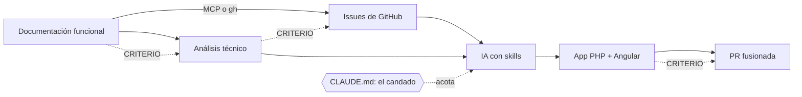

# Clase del 2026-11-26: de la documentación a la PR fusionada, con un equipo de agentes

**Mensaje principal:** con un `CLAUDE.md` que cierra el marco, skills por capa y puntos de control humanos, una IA lleva una app de la documentación funcional a una PR fusionada. Hoy aprendemos a repartir ese trabajo entre agentes que no se pisan.

**Duración estimada:** 20 minutos de apertura (10 diapositivas de 1,5 a 2 minutos, con la demo corta de 2 a 3 minutos dentro de la diapositiva 7). Después empieza el lab (`docs/formacion/lab-agentes-orquestador.md`), que no se repite aquí.

**Fuentes:** `docs/bitacora.md` (pasos 1 a 64), `CLAUDE.md`, `README.md`, `docs/formacion/lab-agentes-orquestador.md` (incluidos los dos ensayos y los planes B), `docs/propuesta-agentes.md`, `.claude/agents/`, `.claude/skills/` y GitHub (`gh issue list --state all`, `gh pr list --state all`), consultados el 2026-11-26.

---

## Diapositiva 1. De la pizarra a la Pull Request

- Una demo de desarrollo asistido por agentes de IA, que empezó el 2026-11-24 con un dibujo en una pizarra (paso 1).
- La app: una Lista de Tareas con plantillas, tareas repetitivas y papelera.
- Stack: PHP 8.3, Symfony 7, Doctrine y SQLite; Angular 22 con Vitest.
- Hoy: cómo se construyó y cómo pasamos de un agente solo a un equipo.

**Notas del orador:** abre con una frase: "hace tres días esto era una pizarra". Enseña el repositorio en GitHub. Aclara que es una demo didáctica: se prioriza la claridad del código. Anuncia el plan: 20 minutos de contexto y después construimos el equipo de agentes con las manos.

## Diapositiva 2. La idea y el flujo

- La documentación se convierte en issues y en un análisis técnico.
- La IA implementa cada issue dentro del marco del `CLAUDE.md`.
- Cada issue acaba en una rama y una PR con `Closes #<nº>`.
- En cada salida hay un CRITERIO: un punto de control humano.



**Notas del orador:** es la pizarra del paso 1 pasada a limpio. Enseña `CLAUDE.md` abierto. El mensaje: si algo no encaja, se cambia primero el candado, con aprobación, y no el código por libre. Cuenta que el MCP de GitHub se sustituyó por la CLI `gh` (paso 59).

## Diapositiva 3. El candado y las firmas en modo aviso

- `CLAUDE.md` fija stack, capas, convenciones de API y reglas del agente.
- Una firma la da una persona en el chat; el agente nunca firma por su cuenta.
- Modo aviso (decisión del 2026-11-25): una firma pendiente no bloquea la clase; se avisa en una línea y se sigue (paso 56).
- Siguen siendo obligatorios: no implementar sin issue, y no abrir PR ni fusionar con tests en rojo.
- Las reglas se negocian y dejan rastro: el `405` entró en el candado con aprobación expresa (pasos 62 a 64).

**Notas del orador:** enseña la tabla "Pendientes de firma" del `CLAUDE.md`: hay 9 filas ahora mismo. Mensaje: un control que se relaja debe dejar rastro; aquí lo deja la tabla. Pregunta al grupo: "¿qué prefieres, un control que bloquea o uno que avisa?" y cuenta por qué aquí se eligió avisar (formación). En un proyecto real, el merge lo revisaría una persona antes de fusionar (paso 47).

## Diapositiva 4. Lo construido (1): backend y frontend base

- Backlog en GitHub: 14 issues en 4 milestones (Infraestructura, Bloque A, Bloque B y Bloque C), con criterios Dado/Cuando/Entonces.
- Backend de la v0.1 completo: `/api/tasks` (8 rutas) y `/api/task-templates` (6 rutas), issues #5 a #9.
- Tests y calidad en local: 95 tests de PHPUnit (267 aserciones), PHPStan y PHP-CS-Fixer con `backend-test.ps1`.
- Frontend base (#3): Angular 22, proxy a la API, interceptor de `problem+json` y 7 tests de Vitest.
- Cifras de GitHub: 9 issues cerrados, 5 abiertos, 10 PR fusionadas.

**Notas del orador:** enseña `gh issue list --state all` o la pestaña de PR. Cada PR cierra su issue sola. Pasa rápido: lo importante no es la app, es cómo se fabricó. Aclara que quedan abiertos #10, #11 y #12 (pantallas), #15 (categorías de la v0.2) y #4 (CI).

## Diapositiva 5. Lo construido (2): skills y agentes de apoyo

- Cadena de skills por capa: `analisis-diseno` → `modelo` → `dto` → `servicio` → `api` → `frontend` → `pruebas`, más `bitacora` y `mensaje-commit`.
- El skill `nueva-feature` es el orquestador de skills: detecta qué capas toca una petición y encadena los skills. No implementa nada por su cuenta.
- Siete agentes de apoyo, cada uno con su comando: `refinador-backlog`, `guardian-candado`, `trazador-reglas`, `qa-exploratorio`, `revisor-seguridad`, `disenador-ui` y `presentador`.
- Ya dieron frutos: el QA encontró el fallo que acabó siendo el issue #23.

| Comando | Agente | Qué hace |
|---|---|---|
| `/revisar-candado` | `guardian-candado` | CUMPLE o NO CUMPLE contra el `CLAUDE.md` |
| `/probar-qa` | `qa-exploratorio` | Prueba la API por HTTP con su propia base de datos |
| `/trazar-reglas` | `trazador-reglas` | Matriz regla → análisis → issue → código → test |

**Notas del orador:** enseña `.claude/skills/` y `.claude/agents/` en el explorador. Cuenta una prueba real del paso 56: `qa-exploratorio` hizo 54 pruebas sobre #8 y #9 (51 OK y 3 hallazgos); uno de ellos, rutas inexistentes con respuesta en HTML, es el #23 que veremos arreglado. Menciona también la prueba del `refinador-backlog`: el #15 no estaba listo para implementar y devolvió 9 preguntas para el PO.

## Diapositiva 6. Skill, agente y comando

| | Skill | Agente | Comando |
|---|---|---|---|
| Responde a | Cómo se hace | Quién lo hace | Cómo se lanza |
| Vive en | `.claude/skills/` | `.claude/agents/` | `.claude/commands/` |
| Contexto | El de quien lo usa | Propio y limpio | El de la conversación |
| Ejemplo | `api`, `nueva-feature` | `guardian-candado` | `/revisar-candado` |

- Permisos mínimos: el guardián no tiene `Edit` ni `Write`, así que no puede corregir.
- Salida con formato fijo: `CUMPLE` o `NO CUMPLE`, `APROBADO` o `REVISAR`. Lo lee otro agente.
- Dos reglas de oro: **quien verifica no corrige** y **quien coordina no implementa**.

**Notas del orador:** abre `.claude/agents/guardian-candado.md` y señala `description` (cuándo usarlo), `tools` (qué puede hacer) y el formato de salida. Pregunta retórica: "¿qué pasaría si el verificador pudiera editar?" Respuesta: marcaría en verde lo que él mismo ha tocado. Es el hilo que retomamos en el lab; aquí solo se plantea.

## Diapositiva 7. El equipo de agentes (y demo corta)

- Cinco agentes que se crean hoy en el lab: `orquestador`, `planificador`, `implementador-backend`, `implementador-frontend` y `verificador`.
- Se suma `guardian-candado`, que ya existe, antes del cierre.
- El orquestador trabaja en la conversación principal, con el comando `/orquestar`, para poder parar y preguntar en los CRITERIO.
- El plan se guarda en `docs/planes/plan-<nº>-<slug>.md`; el verificador da como máximo 3 vueltas de corrección.

```mermaid
flowchart LR
    U([Persona]) -->|/orquestar| O[Orquestador]
    O --> P[Planificador]
    P -.plan.-> O
    O --> B[Implementador backend]
    O --> F[Implementador frontend]
    O --> V[Verificador]
    V -.REVISAR, máx. 3 vueltas.-> O
    O --> G[guardian-candado]
    O --> GH[(Bitácora, commit, PR y merge)]
```

**Notas del orador:** el diagrama es el del lab; no lo expliques paso a paso, eso es el lab. Una idea: cada agente es un sombrero que antes llevaba una sola conversación.

### Demo en vivo (2 a 3 minutos)

Objetivo: ver un agente real en acción y su veredicto, sin pisar la demo larga del lab (`/orquestar #10`). Se usa el guardián sobre el trabajo del #23, que ya está fusionado.

1. Abre Claude Code en la raíz del repositorio y escribe `/agents`. Enseña los siete agentes de apoyo (todavía no están los cinco del lab).
2. Lanza el guardián sobre la PR del #23:

   ```
   /revisar-candado #24
   ```

   Mientras trabaja (unos 25 segundos en el ensayo), abre `docs/planes/plan-23-errores-problem-json.md` y enseña capas afectadas y descartadas.
3. Enseña el veredicto. En el ensayo fue `CUMPLE`. Señala que no ha modificado ningún fichero: `git status`.
4. Cierra con la frase: "dentro de una hora, esto será una pieza más del equipo".

Plan B de la demo: si el agente no responde o tarda, enseña el plan y la PR #24 en GitHub y cuenta el veredicto del ensayo (`CUMPLE`).

## Diapositiva 8. Dos ensayos con datos reales

| Ensayo | Issue | Resultado |
|---|---|---|
| Primero: frontend | #10, en ramas locales, sin PR | Plan 40 s; implementador frontend 5,5 min; verificador 40 s (`APROBADO` en la primera vuelta); guardián 25 s (`CUMPLE`); 42 tests de Vitest en verde; pantallas probadas a mano en 3 min |
| Segundo: backend, con `/orquestar` como comando | #23, PR #24 fusionada | Plan 30 s; implementador backend 2,5 min (95 tests en verde); verificador 20 s (`APROBADO`); guardián 25 s (`CUMPLE`) |

- El primero sumó unos 7 minutos de agentes (435 s); sobra tiempo en el bloque de 30 minutos del lab.
- El #23 se arregló de verdad: `ApiJsonFormatSubscriber` hace que 404 y 405 de `/api` salgan en `application/problem+json`, con 4 tests nuevos.
- Las dos veces, el verificador y el guardián dieron luz verde a la primera. Lo interesante no fueron los aciertos.

**Notas del orador:** enseña la PR #24 en GitHub y el diff pequeño. Subraya que el segundo ensayo fue el de verdad: agentes creados sin commit, como se hará hoy. Esto da confianza: sabemos lo que tarda cada pieza.

## Diapositiva 9. Lo que salió mal y lo que aprendimos

Fallos que encontraron los ensayos y cómo se corrigieron (pasos 61 a 63):

1. **Los agentes nuevos tardaron unos 7 minutos en aparecer** en la sesión; el comando, al momento. Ahora el lab pide crearlos al principio y abrir sesión nueva si no salen.
2. **Los ids de los datos de ejemplo estaban escritos a mano** y la plantilla daba 404. Ahora se leen de cada respuesta.
3. **El verificador y el guardián miraban `main..HEAD`,** pero el commit llega al final: habrían revisado un diff vacío. Ahora miran también los cambios sin commit.
4. **El planificador inventó un agente** (`implementador-pruebas`). Ahora solo asigna agentes que existen.
5. **Los skills terminaban con commit y PR,** y chocaban con agentes que no hacen commits. Ahora el cierre es solo del orquestador.
6. **Nadie podía actualizar el análisis.** Ahora los implementadores pueden tocar `docs/analisis.md` con `analisis-diseno` si el plan lo pide.
7. **El skill `api` se contradecía** (decía que no hacía falta un listener). Corregido.

Y de antes, para el recuerdo:

- PHPUnit "colgado" (paso 42): no era un fallo del código, era el disco al 99 % y el antivirus escaneando más de 5.600 ficheros de `vendor/`.
- El workflow de CI quedó aparcado (paso 52): al token de `gh` le falta el permiso `workflow`. Está en `.github/ci-pendiente.yml`.

**Notas del orador:** esta es la diapositiva más útil de la clase. Mensaje: los agentes fallan en las costuras (permisos, rutas, quién cierra), no en el código; por eso se ensaya antes. Anuncia que hoy quizá les pasen cosas parecidas y que la tabla de planes B del lab ya lo prevé.

## Diapositiva 10. Lo que queda y el paso al lab

- Issues abiertos (5): #10, #11 y #12 (pantallas de Angular), #15 (categorías, v0.2) y #4 (CI aparcada).
- Tareas pendientes del `CLAUDE.md`: tablero de GitHub Projects (falta el permiso `project` del token), entorno Docker y los CRITERIO de las fases 3, 5 y 6.
- Firmas pendientes: 9 filas en "Pendientes de firma" (backlog, categorías, RN-18, stack del frontend, #23 y el `405`).
- Hoy: los agentes del equipo se crean en clase (o se copian de `docs/formacion/agentes-referencia/`) y `/orquestar #10` cierra el primer issue de pantallas.
- Hay propuestas por si sobra tiempo: 15 agentes en `docs/propuesta-agentes.md` (por ejemplo, `evaluador-agentes`).

**Notas del orador:** cierra la apertura con la transición: "lo que ya hay lo hizo un agente solo con skills; ahora lo repartimos". Abre `docs/formacion/lab-agentes-orquestador.md` y empieza por el bloque 0 (preparación). No entres en detalle de los bloques: se explican durante el lab.

---

## Cifras que se han comprobado

| Dato | Valor | Fuente |
|---|---|---|
| Pasos de la bitácora | 64 | `docs/bitacora.md` |
| Issues | 14 en total: 9 cerrados y 5 abiertos | `gh issue list --state all` |
| PR fusionadas | 10 (#13, #14, #16 a #22 y #24) | `gh pr list --state all` |
| Tests del backend | 95 (267 aserciones) | Paso 62 |
| Tests del frontend en `main` | 7 de Vitest | Paso 54 |
| Tests del frontend en la rama del ensayo | 42 | Paso 61 |
| Agentes de apoyo / comandos | 7 / 7 | `.claude/agents/`, `.claude/commands/` |
| Filas en "Pendientes de firma" | 9 | `CLAUDE.md` |

## Pendientes y avisos para quien presenta

- (pendiente) Hora exacta de comienzo de cada ensayo: la bitácora solo da duraciones.
- El guion del lab dice 91 tests del backend en el bloque 0 y en el lab del verificador; desde el #23 hay 95. Conviene decir "95" si se comparan cifras en pantalla.
- El `README.md` aún dice "El merge lo decide siempre una persona", y el `CLAUDE.md` (paso 47) dice que el agente fusiona con los tests en verde. Vale la pena aclararlo en voz alta si alguien lo pregunta.
