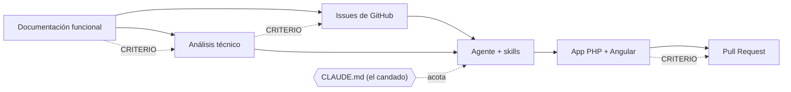

# Clase del 2026-11-26: agentes de IA que construyen una app de principio a fin

**Mensaje principal:** una IA con buenas reglas (un `CLAUDE.md`), skills especializados y puntos de control humanos puede llevar una app desde la documentación funcional hasta código probado y fusionado en Git.

**Duración estimada:** 15 minutos (10 diapositivas, unos 1,5 minutos cada una, más la demo en vivo de 3 a 4 minutos incluida en ese tiempo).

**Fuentes:** `docs/bitacora.md` (pasos 1 a 55), `CLAUDE.md`, `README.md` y GitHub (`gh issue list`, `gh pr list`). Cifras tomadas del estado de GitHub y de la bitácora del 2026-11-25.

---

## Diapositiva 1. De la pizarra a la Pull Request

- Una demo de desarrollo asistido por agentes de IA.
- Partimos de un dibujo en una pizarra y de una carpeta vacía (paso 1).
- La app: una Lista de Tareas con plantillas, tareas repetitivas y papelera.
- Stack: PHP, Symfony, Doctrine y SQLite en el backend; Angular en el frontend.

**Notas del orador:** abre contando que el proyecto empezó con un diagrama en una pizarra y ninguna línea de código. Enseña en pantalla el repositorio en GitHub (`hispafox/DemoAgentes`, privado). Aclara que es una demo didáctica: se prioriza que el código sea claro, no sofisticado.

## Diapositiva 2. El flujo de trabajo: con puntos de control humanos

- La documentación se convierte en issues de GitHub (vía MCP o `gh`).
- En paralelo se genera un análisis técnico.
- La IA implementa cada issue y abre una PR con `Closes #<nº>`.
- En cada salida hay un CRITERIO: una persona revisa antes de avanzar.



**Notas del orador:** es la pizarra del paso 1, pasada a limpio. Insiste en el candado: el `CLAUDE.md` es el diseño que acota lo que puede hacer la IA (paso 3). Si algo no encaja, se cambia primero el `CLAUDE.md`, nunca el código por libre. Enseña el fichero `CLAUDE.md` abierto.

## Diapositiva 3. El candado: `CLAUDE.md` y las firmas

- El `CLAUDE.md` fija stack, arquitectura, convenciones y reglas del agente.
- Las firmas: solo una persona aprueba, el agente nunca firma por su cuenta (paso 21).
- Si un documento firmado cambia, pierde la firma (pasos 34 y 35).
- La regla de bloqueo se suspendió para ir más rápido y todo quedó anotado como "pendiente de firma" (paso 24).

**Notas del orador:** cuenta que las reglas también se negocian: suspendimos la regla de firmas a petición del usuario, pero sin borrarla. Enseña la tabla "Pendientes de firma" del `CLAUDE.md`. Mensaje: un control que se suspende debe dejar rastro.

## Diapositiva 4. Documentar y analizar antes de programar

- Documentación funcional: F-01 a F-19 y RN-01 a RN-18 (pasos 16, 35, 36 y 38).
- El PO responde las preguntas abiertas y el análisis se actualiza (pasos 18, 19 y 36).
- Se cambió Jira por GitHub: épica = milestone, historia = issue (paso 7).
- Backlog inicial: 12 issues en 3 milestones, con criterios Dado/Cuando/Entonces (paso 25).

**Notas del orador:** enseña `docs/app/lista-de-tareas.md` y el diagrama ER de `docs/analisis.md` (paso 29). Cuenta un ejemplo: al revisar el análisis (paso 38) el agente detectó un hueco, la fecha de la siguiente ocurrencia al crear una tarea a mano, y el PO lo resolvió como RN-18. El agente pregunta; no inventa reglas.

## Diapositiva 5. Los skills: un especialista por capa (pasos 37 a 45)

- `mensaje-commit` y `bitacora` (pasos 6 y 11), más `modelo` (paso 28).
- Paso 37: `analisis-diseno`. Paso 39: `dto`, `servicio` y `api`. Paso 43: `pruebas`.
- Cada skill tiene tres modos: `crear`, `actualizar` y `revisar`.
- Cada uno declara qué lee, qué escribe, qué no toca y cómo se verifica.

**Notas del orador:** explica la idea: en vez de un prompt gigante, una cadena de pequeños especialistas con fronteras claras. Enseña la carpeta `.claude/skills/` y abre un `SKILL.md`, por ejemplo el de `modelo`. Detalle útil: los skills se crearon justo antes de necesitarlos, para probarlos con un issue real (paso 39).

## Diapositiva 6. Los tests se suspenden y se reactivan (pasos 33, 42 y 44)

- Los tests se suspendieron el 24 de noviembre porque PHPUnit parecía colgado (paso 33).
- Se reactivaron el 25 de noviembre (paso 42): 17 tests en verde.
- El skill `pruebas` escribió los tests del issue #5: 42 tests y 94 aserciones (paso 44).
- Se resolvió la cabecera `application/problem+json` con configuración, sin código nuevo.

**Notas del orador:** pregunta a la clase por qué creen que PHPUnit "se colgaba" y revela la respuesta en la diapositiva 9. Enseña `php bin/phpunit` en verde. Remarca la regla que nunca se suspendió del todo: sin tests en verde no hay PR ni merge.

## Diapositiva 7. El backend de la 0.1, issue a issue (pasos 41 y 48 a 51)

- #5: gestionar tareas (crear, listar, consultar y modificar).
- #6: completar una tarea y generar la siguiente ocurrencia (RN-05, RN-06).
- #7: papelera (eliminar, ver y restaurar). #8: CRUD de plantillas. #9: crear una tarea desde una plantilla.
- Cada issue sigue la misma cadena: `modelo` → `dto` → `servicio` → `api` → `pruebas` → PR → merge.
- Resultado: backend de la 0.1 completo y 91 tests en verde (paso 51).

**Notas del orador:** enseña en GitHub la lista de PR fusionadas y cómo cada una cierra su issue con `Closes #<nº>`. Cuenta cómo creció la suite: 42 tests tras el #5, 53 tras el #6, 67 tras el #7, 86 tras el #8 y 91 tras el #9. Decisión que conviene contar: el merge lo hace el agente en cuanto los tests están en verde, porque es una demo de clase (paso 47); en un proyecto real se mantendría la revisión previa.

## Diapositiva 8. Infraestructura y frontend: #4, #3 y los skills `frontend` y `nueva-feature` (pasos 52 a 55)

- #4: PHPStan nivel 6, PHP-CS-Fixer y plantilla de PR. El workflow de CI queda aparcado en `.github/ci-pendiente.yml` (paso 52).
- Skill `frontend` (paso 53) y proyecto Angular 22 con Vitest, proxy `/api` e interceptor de errores `problem+json` (paso 54, 7 tests en verde).
- Skill orquestador `nueva-feature` (paso 55): recibe una petición o un issue y encadena los demás skills hasta la PR fusionada.
- El orquestador coordina, no implementa, y para en cada punto de control.

**Notas del orador:** enseña `proxy.conf.json` y cómo un `404` llega al navegador como mensaje en castellano. El orquestador es el cierre natural de la cadena: un solo comando, `/nueva-feature #<nº>`, para el resto de issues. Aclara que los agentes de los documentos de arquitectura aún no se han creado (paso 55).

## Diapositiva 9. Los números reales (a 2026-11-25)

- Issues: 13 en total, 8 cerrados (#1, #2, #3, #5, #6, #7, #8, #9) y 5 abiertos (#4, #10, #11, #12, #15).
- Pull Requests fusionadas: 9 (#13, #14, #16 a #22).
- Tests: 91 en el backend y 7 en el frontend, todos en verde.
- Bitácora: 55 pasos registrados en dos días de trabajo.
- Skills de proyecto: 10 (`mensaje-commit`, `bitacora`, `analisis-diseno`, `modelo`, `dto`, `servicio`, `api`, `pruebas`, `frontend`, `nueva-feature`).

**Notas del orador:** enseña `gh issue list --state all` y `gh pr list --state merged`. Qué falta, dicho con honestidad: pantallas de Angular (#10, #11, #12), categorías de la 0.2 (#15) y activar la CI (#4). Tests de la suite completa tras el último merge del frontend: el backend se contó en el paso 51 y no se ha vuelto a medir (pendiente de confirmar el recuento exacto el día de la clase).

## Diapositiva 10. Lo que salió mal y aprendimos

- **El antivirus que "colgaba" PHPUnit (pasos 31 y 42).** Defender escaneaba más de 5.600 ficheros de `vendor/` con el disco al 99 %. No era un fallo del código. Solución: exclusión de la carpeta del repositorio.
- **El token sin permiso `workflow` (paso 52).** GitHub rechazó el push del workflow. La CI no hacía falta para el curso, así que se aparcó en `.github/ci-pendiente.yml` y el issue #4 sigue abierto.
- **El tablero de Projects sin crear (paso 25).** Al token de `gh` le faltaba el permiso `project`.
- **Errores en HTML en vez de JSON (paso 41).** Resuelto con `format: 'json'` en la ruta.
- **Frontmatter de un skill que no cargaba (paso 9).** Los dos puntos sin comillas en YAML; se arregló con `description: >-`.
- **El modelo "desapareció" del editor (paso 33).** Solo era otra rama; el código seguía en `feature/5-gestionar-tareas`.

**Notas del orador:** es la diapositiva con más valor para la clase. Mensaje: la mayoría de los problemas fueron del entorno (antivirus, permisos, Windows), no de la IA, y el agente los diagnosticó antes de cambiar nada (paso 42). Pregunta a la clase qué habrían hecho con un PHPUnit "colgado".

---

## Demo en vivo (3 a 4 minutos)

Desde la raíz del repositorio, en PowerShell:

1. Estado y contexto del proyecto en un chat nuevo:
   ```
   /bitacora retomar
   ```
2. Arrancar el backend (http://127.0.0.1:8000):
   ```powershell
   .\scripts\backend-start.ps1
   ```
3. Probar la API a mano: crear una tarea semanal y completarla, para ver cómo nace la siguiente ocurrencia:
   ```powershell
   curl.exe -i -X POST http://127.0.0.1:8000/api/tasks -H "Content-Type: application/json" -d "{\"title\":\"Regar las plantas\",\"recurrence\":\"weekly\"}"
   curl.exe -i -X POST http://127.0.0.1:8000/api/tasks/1/complete
   curl.exe -i http://127.0.0.1:8000/api/tasks/999
   ```
   Lo que se debe ver: `201` con `Location`, `200` con la tarea completada y la nueva ocurrencia, y `404` en `application/problem+json`.
4. Lanzar tests, análisis estático y mapeo de Doctrine:
   ```powershell
   .\scripts\backend-test.ps1
   ```
5. Parar el servidor:
   ```powershell
   .\scripts\backend-stop.ps1
   ```
6. Si hay tiempo, abrir el siguiente issue con el orquestador (por ejemplo, las pantallas de tareas):
   ```
   /nueva-feature #10
   ```
   Para ver solo el plan sin implementar: `/nueva-feature plan #10`.

**Plan B si algo falla:** enseñar el resultado ya fusionado en GitHub (PR #22) y la salida de `.\scripts\backend-test.ps1` grabada de antemano. Recuerda comprobar que el puerto 8000 esté libre y que Defender tenga la exclusión del repositorio.

---

## Cierre y preguntas

- Qué nos llevamos: reglas claras (`CLAUDE.md`), especialistas pequeños (skills), tests como freno y personas en los puntos de control.
- Siguiente paso: pantallas de Angular (#10, #11, #12), categorías de la 0.2 (#15) y activar la CI (#4).
- Pendiente: la fecha de la clase es el 2026-11-26 y los datos son del 2026-11-25; conviene refrescar las cifras de la diapositiva 9 antes de empezar.
