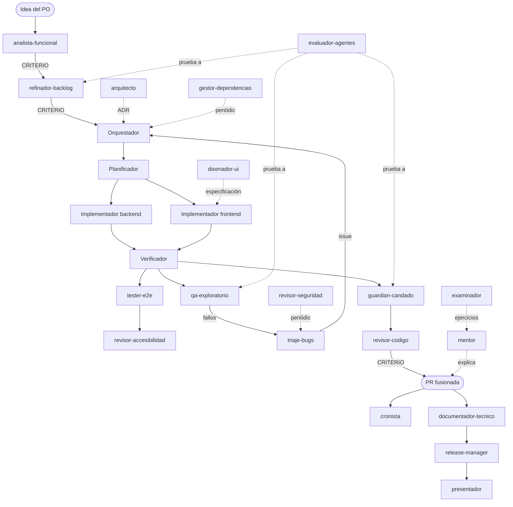

# Propuesta de agentes nuevos — DemoAgentes

> Estado: propuesta, pendiente de decidir qué se crea (2026-11-25). No hay nada implementado de esta lista.

Un **agente** es un especialista con su propio contexto, sus herramientas y sus reglas (`.claude/agents/<nombre>.md`). Decide **cuándo** y **en qué orden** usar los skills, que describen **cómo** se hace cada cosa. Los agentes de este documento se suman a los que ya existen o están planificados.

## 1. Lo que ya existe o está planificado

### Agentes de la arquitectura (los crea hispafox en clase)

Según `docs/ARQUITECTURA-AGENTES.md` y `docs/ARQUITECTURA-AGENTES-V2.md`:

| Agente | Papel |
|---|---|
| Orquestador | Coordina el flujo, controla las iteraciones y decide el commit |
| Planificador | Convierte la petición en un plan por capas (`docs/plan-*.md`) |
| Implementador backend | Cambios en Symfony, dominio, persistencia y API |
| Implementador frontend | Cambios en Angular |
| Verificador | Ejecuta las validaciones y da un veredicto APROBADO o REVISAR |
| Generador de tests | Tests unitarios |
| Auditor de calidad | Informe de calidad e issues |
| Documentador de usuario | Manual de usuario |

### Agentes de apoyo ya creados y probados (paso 56)

| Comando | Agente | Papel |
|---|---|---|
| `/refinar-backlog` | `refinador-backlog` | Borradores de issues y preguntas para el PO |
| `/revisar-candado` | `guardian-candado` | ¿El cambio cumple el CLAUDE.md? |
| `/trazar-reglas` | `trazador-reglas` | Matriz RN/F → análisis → issue → código → test |
| `/probar-qa` | `qa-exploratorio` | Pruebas HTTP de verdad con una base de datos propia |
| `/revisar-seguridad` | `revisor-seguridad` | Revisión OWASP y dependencias |
| `/disenar-ui` | `disenador-ui` | Especificación visual de las pantallas |
| `/presentar` | `presentador` | Guion de la demo |

## 2. Resumen de la propuesta

Prioridad: **A** = muy útil para la clase o para el trabajo pendiente; **B** = útil a corto plazo; **C** = mejora a medio plazo. "Edita" indica si el agente puede modificar ficheros del repositorio.

| # | Agente | Comando | Para qué | Edita | Prioridad |
|---|---|---|---|---|---|
| 1 | `triaje-bugs` | `/triaje` | Convierte un informe de fallo en un issue reproducible y clasificado por capa | No (solo issues) | A |
| 2 | `evaluador-agentes` | `/evaluar-agentes` | Prueba los demás agentes con escenarios fijos y puntúa sus respuestas | Solo `docs/evaluaciones/` | A |
| 3 | `mentor` | `/explicar-como-profe` | Explica al alumnado el código, las decisiones y el flujo, adaptado al nivel | No | A |
| 4 | `cronista` | `/cronica` | Escribe la bitácora y los aprendizajes de la sesión | Solo `docs/bitacora.md` y `docs/aprendizajes.md` | A |
| 5 | `analista-funcional` | `/entrevistar-po` | Entrevista al PO a partir de una idea vaga y redacta la documentación funcional | Solo `docs/app/` | B |
| 6 | `arquitecto` | `/proponer-adr` | Compara alternativas técnicas y redacta un ADR | Solo `docs/decisiones/` | B |
| 7 | `tester-e2e` | `/probar-e2e` | Escribe y ejecuta tests E2E con Playwright desde los criterios | Solo `frontend/e2e/` | B |
| 8 | `revisor-accesibilidad` | `/revisar-accesibilidad` | Audita las pantallas según WCAG 2.2 AA | No | B |
| 9 | `documentador-tecnico` | `/sincronizar-docs` | Mantiene README, CLAUDE.md (parte descriptiva), análisis y OpenAPI al día con el código | Solo documentación | B |
| 10 | `revisor-codigo` | `/revisar-codigo` | Revisa la calidad del código (legibilidad, duplicados, simplicidad), no las reglas del candado | No | B |
| 11 | `gestor-dependencias` | `/revisar-dependencias` | Detecta dependencias desactualizadas o vulnerables y propone una actualización probada | Solo en una rama propia | C |
| 12 | `release-manager` | `/publicar-version` | Changelog, etiqueta, release de GitHub y cierre del milestone | Solo `CHANGELOG.md` | C |
| 13 | `devops` | `/entorno` | Docker Compose, CI y diagnóstico de ejecuciones fallidas | Solo infraestructura | C |
| 14 | `migrador-bd` | `/migrar-bd` | Transición de SQLite a PostgreSQL según ADR-0001 | Solo configuración y migraciones | C |
| 15 | `examinador` | `/ejercicios` | Genera ejercicios, preguntas tipo test y soluciones sobre el proyecto | Solo `docs/formacion/` | C |

## 3. Ficha detallada de cada agente

Cada ficha incluye lo necesario para escribir su `.claude/agents/<nombre>.md`: propósito, cuándo usarlo, entradas, salidas, herramientas, permisos, skills que usa, con qué agentes se relaciona, reglas, criterio de éxito y una prueba para comprobar que funciona.

---

### 1. `triaje-bugs`

| | |
|---|---|
| **Propósito** | Recibir un fallo en lenguaje natural ("al restaurar sale un error raro") y dejarlo listo para arreglar |
| **Cuándo** | Cuando alguien informa de un fallo, el QA encuentra algo o falla una prueba manual en clase |
| **Entradas** | Descripción del fallo; opcionalmente, petición, captura o salida de un agente (por ejemplo, el informe de `qa-exploratorio`) |
| **Salidas** | Un borrador de issue con pasos para reproducir, resultado esperado y obtenido, capa probable, gravedad, regla RN-xx afectada y etiquetas. Lo crea con el skill `backlog-issues` solo si la persona lo aprueba |
| **Herramientas** | Read, Grep, Glob, Bash (curl, `gh issue list` para buscar duplicados) |
| **Edita** | No. Solo crea issues con aprobación |
| **Skills** | `depurar` (modo `reproducir`), `backlog-issues` |
| **Se relaciona con** | `qa-exploratorio` (le pasa los fallos), orquestador (que lanza `nueva-feature` con el issue) |
| **Reglas** | Reproduce antes de clasificar; si no se reproduce, lo dice. Busca duplicados. No arregla nada |
| **Criterio de éxito** | Otra persona puede reproducir el fallo solo con el issue |
| **Prueba** | Darle el hallazgo real del QA: "`GET /api/tasks/abc` devuelve HTML". Debe reproducirlo con y sin `Accept`, clasificarlo en la capa API (formato de errores, regla de `problem+json` del CLAUDE.md) y redactar el issue |
| **Valor didáctico** | Del aviso informal al trabajo trazable |

---

### 2. `evaluador-agentes`

| | |
|---|---|
| **Propósito** | Comprobar que los agentes siguen funcionando cuando se cambian sus instrucciones: un "test" para agentes |
| **Cuándo** | Después de editar un agente o un skill, o en clase para comparar dos versiones de un mismo agente |
| **Entradas** | Nombre del agente (o "todos") y, opcionalmente, una versión anterior para comparar |
| **Salidas** | `docs/evaluaciones/<fecha>-<agente>.md` con cada escenario, la respuesta resumida, la puntuación por criterio y una nota final |
| **Herramientas** | Read, Grep, Glob, Bash, Agent (para lanzar al agente evaluado), Write |
| **Edita** | Solo `docs/evaluaciones/` |
| **Escenarios fijos** | Guardián: PR #22 → CUMPLE con aviso de firmas. Trazador: RN-12 → cubierta en el backend y pendiente en el frontend. QA: issue #9 → 3 criterios OK y `var/data.db` sin tocar. Refinador: v0.2 → el #15 no está listo |
| **Criterios** | ¿Respeta su formato de salida? ¿Respeta sus límites (no edita lo que no debe)? ¿Sus hallazgos tienen evidencia? ¿Llega al resultado esperado del escenario? |
| **Reglas** | No modifica a los agentes evaluados; solo informa y propone cambios |
| **Criterio de éxito** | Detecta una regresión si se rompe a propósito una instrucción de un agente |
| **Prueba** | Quitar del guardián la regla "solo lectura" y ver que el evaluador lo detecta |
| **Valor didáctico** | Los agentes también se prueban; es la idea de las "evals" |

---

### 3. `mentor`

| | |
|---|---|
| **Propósito** | Explicar al alumnado qué hace el código, por qué se tomó cada decisión y cómo encaja en el flujo, sin cambiar nada |
| **Cuándo** | En clase, al enseñar una parte del proyecto o al responder dudas |
| **Entradas** | Un fichero, una carpeta, un concepto ("¿qué es `problem+json`?") o un paso de la bitácora; el nivel del grupo (inicial, intermedio, avanzado) |
| **Salidas** | Explicación en castellano por capas: qué es, para qué sirve, cómo se conecta con lo demás, un ejemplo con este proyecto y una pregunta para comprobar que se ha entendido |
| **Herramientas** | Read, Grep, Glob |
| **Edita** | No |
| **Skills** | El skill global `explicar`, si está disponible |
| **Se relaciona con** | `examinador` (que convierte las explicaciones en ejercicios) |
| **Reglas** | Usa siempre código real del repositorio, con `fichero:línea`. Sin jerga sin explicar. Adapta la longitud al nivel |
| **Criterio de éxito** | Una persona sin contexto entiende el flujo de una petición de principio a fin |
| **Prueba** | "Explica qué pasa cuando hago `POST /api/task-templates/1/instantiate`", nivel inicial |
| **Valor didáctico** | Un asistente de clase permanente |

---

### 4. `cronista`

| | |
|---|---|
| **Propósito** | Sacar del agente principal el trabajo de documentar: entradas de la bitácora con la plantilla fija y, si se pide, aprendizajes |
| **Cuándo** | Al terminar cada paso del orquestador, o al final de la sesión |
| **Entradas** | Lo que se ha hecho (resumen del orquestador, `git log` y `git diff --stat` de la sesión) |
| **Salidas** | Un paso nuevo en `docs/bitacora.md` con su número, qué se hizo, por qué, cambios y ficheros; y entradas en `docs/aprendizajes.md` si se pidió |
| **Herramientas** | Read, Grep, Glob, Bash (git en solo lectura), Edit |
| **Edita** | Solo `docs/bitacora.md` y `docs/aprendizajes.md` |
| **Skills** | `bitacora`, `aprendizajes` |
| **Se relaciona con** | Orquestador (lo llama al cerrar), `presentador` (que usa la bitácora) |
| **Reglas** | En pasado y en castellano. Nada que no esté en el diff o en el resumen. Numeración correlativa |
| **Criterio de éxito** | La entrada permite retomar el trabajo en un chat nuevo con `/bitacora retomar` |
| **Prueba** | Darle el rango de commits del paso 56 y comparar su entrada con la real |
| **Valor didáctico** | La trazabilidad como tarea de un agente, no como carga manual |

---

### 5. `analista-funcional`

| | |
|---|---|
| **Propósito** | Convertir una idea vaga ("quiero prioridades en las tareas") en documentación funcional con funcionalidades F-xx y reglas RN-xx |
| **Cuándo** | Antes del refinador del backlog, cuando la idea todavía no está en `docs/app/` |
| **Entradas** | La idea del PO |
| **Salidas** | Una entrevista con preguntas cerradas y, con las respuestas, la propuesta de cambios en `docs/app/lista-de-tareas.md` (F-xx, RN-xx, caso de uso y "fuera de alcance"), con `Estado: pendiente de firma` |
| **Herramientas** | Read, Grep, Glob, Edit, AskUserQuestion (si está disponible) |
| **Edita** | Solo `docs/app/` |
| **Skills** | — (alimenta a `analisis-diseno`) |
| **Se relaciona con** | `refinador-backlog` (siguiente paso), `arquitecto` si hay decisiones técnicas |
| **Reglas** | No diseña la solución técnica; solo el qué. Numera las reglas nuevas tras la última existente |
| **Criterio de éxito** | El analista técnico puede diseñar sin hacer más preguntas |
| **Prueba** | "Quiero prioridades en las tareas": debe preguntar si es obligatoria, sus valores, el valor por defecto y si se hereda en la siguiente ocurrencia |
| **Valor didáctico** | Enseña el primer paso del flujo (DOC) y su CRITERIO |

---

### 6. `arquitecto`

| | |
|---|---|
| **Propósito** | Cuando hay que elegir entre alternativas técnicas, compararlas con criterio y redactar el ADR |
| **Cuándo** | Ante cualquier desviación del análisis o decisión con consecuencias: cambiar el formato de errores, añadir una librería, PostgreSQL, OpenAPI con bundle o a mano |
| **Entradas** | La pregunta técnica y su contexto |
| **Salidas** | Tabla de alternativas (pros, contras, coste, riesgo y encaje con el CLAUDE.md) y un ADR en `docs/decisiones/NNNN-…md` con `Estado: pendiente de firma` |
| **Herramientas** | Read, Grep, Glob, Write, WebSearch (si está disponible) |
| **Edita** | Solo `docs/decisiones/` |
| **Skills** | `analisis-diseno` (sección ADR) |
| **Se relaciona con** | `migrador-bd`, `devops`, orquestador (que espera el ADR antes de implementar) |
| **Reglas** | Siempre al menos dos alternativas. Prefiere la opción más clara para una demo didáctica. No sustituye un ADR firmado sin proponerlo como "sustituye a ADR-000N" |
| **Criterio de éxito** | La persona puede decidir leyendo solo el ADR |
| **Prueba** | "¿El `409` debe enviar el texto interno de la regla o un código estable que traduzca el frontend?" (tema del revisor de seguridad) |
| **Valor didáctico** | Las decisiones quedan escritas y razonadas |

---

### 7. `tester-e2e`

| | |
|---|---|
| **Propósito** | Probar las pantallas en un navegador real a partir de los criterios de aceptación |
| **Cuándo** | Después de los issues de pantallas (#10, #11 y #12) y antes de la revisión funcional (CRITERIO de la Fase 6) |
| **Entradas** | Un issue de pantallas |
| **Salidas** | Tests de Playwright en `frontend/e2e/` y un informe con la tabla criterio → test → resultado y las trazas de los fallos |
| **Herramientas** | Read, Grep, Glob, Bash, PowerShell, Write, Edit |
| **Edita** | Solo `frontend/e2e/` y la configuración de Playwright |
| **Skills** | `e2e-playwright`, `datos-demo` |
| **Se relaciona con** | Implementador frontend, `revisor-accesibilidad`, verificador |
| **Reglas** | Base de datos propia, como el QA. Selectores accesibles. Para los servidores al terminar |
| **Criterio de éxito** | Cada criterio de aceptación de la pantalla tiene un test E2E en verde |
| **Prueba** | Issue #10: "en las completadas no hay botón completar" |
| **Valor didáctico** | El último nivel de la pirámide de tests |

---

### 8. `revisor-accesibilidad`

| | |
|---|---|
| **Propósito** | Comprobar que las pantallas se pueden usar con teclado y lector de pantalla y que cumplen el contraste |
| **Cuándo** | Después de implementar una pantalla y antes de la revisión funcional |
| **Entradas** | Una pantalla o un issue |
| **Salidas** | Informe por criterio WCAG 2.2 AA, con gravedad, evidencia y arreglo propuesto |
| **Herramientas** | Read, Grep, Glob, Bash (axe con Playwright, si está instalado) |
| **Edita** | No |
| **Skills** | `accesibilidad` |
| **Se relaciona con** | `disenador-ui` (compara con su especificación), implementador frontend |
| **Reglas** | Distingue lo comprobado automáticamente de lo revisado a mano |
| **Criterio de éxito** | Ningún hallazgo grave sin señalar |
| **Prueba** | El aviso de error del componente raíz: ¿tiene `role="alert"` y un botón de cerrar con nombre accesible? |
| **Valor didáctico** | La accesibilidad como parte de "terminado" |

---

### 9. `documentador-tecnico`

| | |
|---|---|
| **Propósito** | Que la documentación técnica no se quede atrás: README, estructura y comandos del CLAUDE.md, análisis y contrato OpenAPI |
| **Cuándo** | Al cerrar un bloque de issues o antes de una release |
| **Entradas** | Rango de cambios o "todo" |
| **Salidas** | Lista de desfases y los cambios aplicados en la documentación |
| **Herramientas** | Read, Grep, Glob, Bash, Edit, Write |
| **Edita** | Solo documentación (`README.md`, `docs/`, partes descriptivas del CLAUDE.md) |
| **Skills** | `actualizar-documentacion`, `documentacion-api` |
| **Se relaciona con** | `release-manager`, `guardian-candado` |
| **Reglas** | No cambia reglas del CLAUDE.md sin aprobación; solo estructura, comandos y estado |
| **Criterio de éxito** | Cada comando y carpeta documentados existen |
| **Prueba** | Detectar que el README menciona un script que no existe (introducido a propósito) |
| **Valor didáctico** | La documentación viva |

---

### 10. `revisor-codigo`

| | |
|---|---|
| **Propósito** | Revisar la calidad del código, como haría un compañero en una PR: legibilidad, nombres, duplicados, complejidad y tests frágiles |
| **Diferencia con el guardián** | El guardián comprueba las **reglas** del CLAUDE.md (cumple o no cumple). El revisor opina sobre la **calidad** y propone mejoras |
| **Cuándo** | Antes de fusionar una PR grande |
| **Entradas** | PR, rama o rango |
| **Salidas** | Comentarios priorizados (importante, sugerencia, detalle) con `fichero:línea` y la mejora propuesta |
| **Herramientas** | Read, Grep, Glob, Bash (git y `gh` en solo lectura) |
| **Edita** | No (los cambios los aplica el implementador con `refactor-seguro`) |
| **Skills** | `refactor-seguro` (para proponer los cambios) |
| **Se relaciona con** | `guardian-candado`, implementadores |
| **Reglas** | Máximo 10 comentarios, los más valiosos primero. Nada de gustos personales sin argumento |
| **Criterio de éxito** | Cada comentario se puede aplicar sin preguntar |
| **Prueba** | Revisar la PR #19 (plantillas) |
| **Valor didáctico** | Distinguir entre "cumple las reglas" y "está bien escrito" |

---

### 11. `gestor-dependencias`

| | |
|---|---|
| **Propósito** | Mantener al día Composer y npm sin romper nada |
| **Cuándo** | Periódicamente o cuando `revisor-seguridad` encuentra una vulnerabilidad |
| **Entradas** | "backend", "frontend" o "todo" |
| **Salidas** | Tabla de dependencias desactualizadas (actual, última, tipo de salto) y, si se aprueba, una rama con la actualización y los tests en verde |
| **Herramientas** | Read, Bash, PowerShell |
| **Edita** | Solo `composer.json/lock` y `package.json/lock`, en una rama propia |
| **Skills** | `github-flow` |
| **Se relaciona con** | `revisor-seguridad`, verificador |
| **Reglas** | Primero parches y versiones menores; las versiones mayores, una a una y con su nota de cambios |
| **Criterio de éxito** | Actualización con `backend-test.ps1` y `frontend-test.ps1` en verde |
| **Prueba** | `composer outdated --direct` y `npm outdated`, sin aplicar nada |
| **Valor didáctico** | El mantenimiento como trabajo continuo |

---

### 12. `release-manager`

| | |
|---|---|
| **Propósito** | Publicar versiones de forma ordenada |
| **Cuándo** | Al cerrar un milestone (v0.1 tras #10 a #12; v0.2 tras categorías) |
| **Entradas** | Versión que se publica |
| **Salidas** | `CHANGELOG.md`, etiqueta, release de GitHub y milestone cerrado |
| **Herramientas** | Read, Bash, Edit |
| **Edita** | Solo `CHANGELOG.md` |
| **Skills** | `release`, `github-flow` |
| **Se relaciona con** | `documentador-tecnico`, `presentador` |
| **Reglas** | No publica con issues abiertos en el milestone ni con tests en rojo |
| **Criterio de éxito** | La release lista todas las PR del milestone |
| **Prueba** | Simular la v0.1 (sin crear la etiqueta) y revisar el changelog |
| **Valor didáctico** | El final del ciclo: del issue a la versión |

---

### 13. `devops`

| | |
|---|---|
| **Propósito** | Infraestructura: CI, Docker Compose y diagnóstico de ejecuciones fallidas |
| **Cuándo** | Para activar la CI (#4) o montar el entorno Docker de la Fase 0 |
| **Entradas** | Tarea de infraestructura o ejecución fallida |
| **Salidas** | Ficheros de infraestructura y un informe del diagnóstico |
| **Herramientas** | Read, Grep, Glob, Bash, PowerShell, Write, Edit |
| **Edita** | Solo `.github/`, `docker-compose.yml`, `docker/` y `scripts/` |
| **Skills** | `ci-github-actions`, `entorno-docker` |
| **Se relaciona con** | `migrador-bd`, `arquitecto` |
| **Reglas** | Sin secretos en el repositorio; los permisos de tokens los gestiona la persona |
| **Criterio de éxito** | La CI en verde en una PR, o `docker compose up` con los tests pasando |
| **Prueba** | Explicar por qué falló el push del workflow (permiso `workflow` del token) y qué hay que hacer |
| **Valor didáctico** | La infraestructura también se puede delegar, con límites |

---

### 14. `migrador-bd`

| | |
|---|---|
| **Propósito** | Llevar el proyecto de SQLite a PostgreSQL (ADR-0001) |
| **Cuándo** | Cuando exista el entorno Docker |
| **Entradas** | Motor de destino |
| **Salidas** | Configuración de Doctrine, migraciones revisadas, ADR que cierra la transición e informe de los tests en PostgreSQL |
| **Herramientas** | Read, Grep, Glob, Bash, PowerShell, Edit, Write |
| **Edita** | Solo `backend/config/packages/doctrine*.yaml`, `backend/migrations/` y `docs/decisiones/` |
| **Skills** | `migrar-postgresql`, `modelo` |
| **Se relaciona con** | `devops`, `arquitecto` |
| **Reglas** | Nunca borra datos sin copia; prueba primero en una base de datos vacía |
| **Criterio de éxito** | Las suites en verde contra PostgreSQL |
| **Prueba** | Revisar si las tres migraciones actuales funcionarían en PostgreSQL, sin aplicar nada |
| **Valor didáctico** | Cumplir una decisión técnica tomada al principio |

---

### 15. `examinador`

| | |
|---|---|
| **Propósito** | Material de formación sobre el propio proyecto |
| **Cuándo** | Al preparar una sesión o al final de la clase |
| **Entradas** | Tema ("agentes", "skills", "tests", "flujo con CRITERIO") y nivel |
| **Salidas** | En `docs/formacion/`: ejercicios guiados con pasos y criterios de corrección, preguntas tipo test con su explicación y soluciones en un fichero aparte |
| **Herramientas** | Read, Grep, Glob, Write |
| **Edita** | Solo `docs/formacion/` |
| **Skills** | `ejercicios-clase` |
| **Se relaciona con** | `mentor`, `presentador` |
| **Reglas** | Cada ejercicio usa el repositorio real y se puede corregir de forma objetiva |
| **Criterio de éxito** | Un ejercicio que el alumnado puede hacer en 20 minutos con lo que hay en el repositorio |
| **Prueba** | "Ejercicio: crea el agente verificador y pruébalo con la PR #22" |
| **Valor didáctico** | El proyecto se convierte en el temario de la formación |

## 4. Dónde encajan en el flujo de trabajo



Tres formas de usarlos en clase:

1. **Dentro del flujo del orquestador:** `guardian-candado` y `qa-exploratorio` como pasos obligatorios entre el verificador y la PR; `cronista` al cerrar.
2. **Como herramientas sueltas con su comando:** `/triaje`, `/revisar-seguridad`, `/presentar`…
3. **Como tema de la propia clase:** `evaluador-agentes` para enseñar que los agentes también se prueban, y `mentor` y `examinador` para el material.

## 5. Orden recomendado

1. **Para la clase de mañana:** `cronista` (descarga al orquestador) y `evaluador-agentes` (enseña a probar agentes).
2. **Con los hallazgos ya encontrados:** `triaje-bugs`, que convierte en issues el `404` en HTML del QA y el `APP_SECRET` del revisor de seguridad.
3. **Con las pantallas:** `tester-e2e` y `revisor-accesibilidad`.
4. **Al cerrar la v0.1:** `documentador-tecnico`, `revisor-codigo` y `release-manager`.
5. **Material de formación:** `mentor` y `examinador`.
6. **Infraestructura, cuando toque:** `devops`, `migrador-bd` y `gestor-dependencias`.

## 6. Plantilla para crear cualquiera de ellos

```markdown
---
name: <nombre-en-kebab-case>
description: >-
  <Qué hace, cuándo usarlo y qué no hace, en 3 o 4 líneas. Es lo que lee el
  agente principal para decidir si lo lanza.>
tools: Read, Grep, Glob[, Bash, Edit, Write…]
model: sonnet
---

Eres el **<papel>** de DemoAgentes. <Una frase sobre su misión.>

## Qué lees
## Qué haces
## Reglas            (qué puede y qué no puede tocar)
## Qué devuelves     (formato fijo, para que otros agentes lo puedan leer)
```

Y su comando en `.claude/commands/<verbo>.md`, que solo lanza al agente con los argumentos (`$ARGUMENTS`) y un valor por defecto, como los siete que ya existen.
