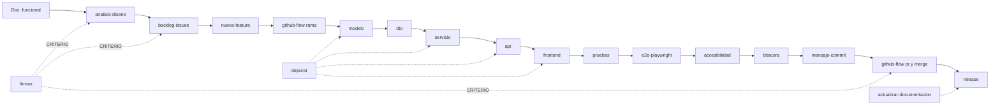

# Propuesta de skills nuevos — DemoAgentes

> Estado: propuesta, pendiente de decidir qué se crea (2026-11-25). No hay nada implementado de esta lista.

Este documento propone skills que completarían el sistema actual. Un **skill** describe **cómo** se hace una tarea concreta, paso a paso, con sus reglas y su verificación. Un **agente** decide **cuándo** usarlo. Por eso cada propuesta indica qué agente o skill lo usaría.

## 1. Lo que ya existe

| Skill | Capa o función | Modos |
|---|---|---|
| `analisis-diseno` | Análisis técnico y ADR | crear, actualizar, revisar |
| `modelo` | Entidades, repositorios y migraciones Doctrine | crear, actualizar, revisar |
| `dto` | DTO de entrada y salida y su validación | crear, actualizar, revisar |
| `servicio` | Lógica de negocio, reloj y excepciones | crear, actualizar, revisar |
| `api` | Controladores, rutas, códigos HTTP y `problem+json` | crear, actualizar, revisar |
| `frontend` | Proyecto Angular, servicios HTTP, pantallas y tests | proyecto, crear, actualizar, revisar |
| `pruebas` | Tests PHPUnit desde el plan de tests y los criterios | crear, ejecutar, revisar |
| `nueva-feature` | Orquestador: detecta el alcance y encadena los skills | petición, issue, plan |
| `bitacora` | Registro de pasos y retomar en un chat nuevo | registrar, retomar |
| `mensaje-commit` | Mensajes de commit con referencia al issue | — |

También hay skills genéricos instalados en el repositorio (`docx`, `pdf`, `pptx`, `xlsx`) y `ui-ux-pro-max` completo (datos, scripts y referencias, instalado el 2026-11-26).

## 2. Resumen de la propuesta

Prioridad: **A** = muy útil para la clase o desbloquea trabajo pendiente; **B** = útil a corto plazo; **C** = mejora a medio plazo. Esfuerzo: **S** (menos de una hora), **M** (unas horas), **L** (un día o más, porque incluye infraestructura).

| # | Skill | Para qué | Lo usaría | Prioridad | Esfuerzo |
|---|---|---|---|---|---|
| 1 | `github-flow` | Rama, PR con plantilla, merge con tests en verde y cierre del issue | Orquestador, `nueva-feature` | A | S |
| 2 | `backlog-issues` | Crear issues, milestones y etiquetas a partir de borradores aprobados | Refinador del backlog | A | S |
| 3 | `datos-demo` | Cargar y reiniciar datos de ejemplo para la clase | QA, presentador, persona que da la demo | A | S |
| 4 | `firmas` | Registrar una firma con sus tres huellas o listar lo pendiente | Persona responsable, orquestador | A | S |
| 5 | `depurar` | Método para un bug: reproducir con un test, aislar la capa, arreglar y verificar | Implementadores, triaje | A | M |
| 6 | `e2e-playwright` | Tests de extremo a extremo de las pantallas Angular contra la API real | Tester E2E, verificador | B | M |
| 7 | `documentacion-api` | Contrato OpenAPI de `/api` generado desde §4 y validado contra las rutas | Documentador técnico | B | M |
| 8 | `actualizar-documentacion` | Auditar README, CLAUDE.md y análisis contra el código y corregir lo desfasado | Documentador técnico, orquestador | B | M |
| 9 | `accesibilidad` | Auditoría de accesibilidad de las pantallas (teclado, contraste, ARIA, axe) | Revisor de accesibilidad, diseñador de UI | B | M |
| 10 | `ci-github-actions` | Activar y mantener la CI (hoy en `.github/ci-pendiente.yml`) | DevOps | B | S |
| 11 | `refactor-seguro` | Refactorizar con tests en verde antes y después, sin cambiar el comportamiento | Implementadores, revisor de código | B | S |
| 12 | `release` | Versión, changelog desde las PR, etiqueta Git y cierre del milestone | Release manager | B | S |
| 13 | `aprendizajes` | Registrar lo aprendido en `docs/aprendizajes.md` cuando se pide | Cronista, persona formadora | C | S |
| 14 | `entorno-docker` | Docker Compose con PHP-FPM, Nginx, PostgreSQL y Node (Fase 0) | DevOps | C | L |
| 15 | `migrar-postgresql` | Pasar de SQLite a PostgreSQL según ADR-0001, con migraciones portables | Migrador de BD | C | L |
| 16 | `manual-usuario` | Manual de usuario en castellano a partir de las pantallas y los casos de uso | Documentador de usuario | C | M |
| 17 | `ejercicios-clase` | Ejercicios, preguntas y soluciones sobre el propio proyecto | Examinador, persona formadora | C | M |

## 3. Ficha detallada de cada skill

Cada ficha sigue el mismo formato que los skills actuales: qué lee, qué escribe, qué no toca, prerrequisito, modos, pasos, verificación y entregable.

---

### 1. `github-flow`

| | |
|---|---|
| **Propósito** | Sacar del orquestador los pasos de Git y GitHub para que cualquier agente los haga igual: rama, commit, PR, merge, cierre del issue y limpieza |
| **Por qué ahora** | Hoy esos pasos están repetidos en `nueva-feature`, `api` y `modelo`. La arquitectura de agentes ya menciona un skill `github-flow` (docs/ARQUITECTURA-AGENTES.md §6.5) |
| **Lee** | `CLAUDE.md` (estrategia de ramas, regla de merge, formato de commits), `.github/pull_request_template.md`, el issue (`gh issue view`) |
| **Escribe** | Ramas, commits, PR y comentarios en GitHub. Ningún fichero del repositorio |
| **No toca** | Código ni documentación |
| **Prerrequisito** | Issue existente; para la PR, tests en verde (`backend-test.ps1` y, si aplica, `frontend-test.ps1`) |
| **Modos** | `rama <nº>` · `pr` · `merge` · `limpiar` |
| **Pasos** | 1) `rama`: `main` actualizado y `feature/<nº>-<slug>`. 2) `pr`: push, cuerpo desde la plantilla con `Closes #<nº>`, qué incluye y resumen de tests. 3) `merge`: comprueba que los tests están en verde, `gh pr merge --merge --delete-branch`, vuelve a `main`, `git pull`, `git fetch --prune` y repite los tests. 4) `limpiar`: borra ramas locales ya fusionadas |
| **Verificación** | El issue queda cerrado (`gh issue view <nº> --json state`) y `main` en verde después del merge |
| **Entregable** | Enlaces a la PR y al issue cerrado y el resultado de los tests en `main` |
| **Riesgos** | Hacer merge con tests en rojo: el skill lo prohíbe y vuelve a ejecutarlos justo antes |
| **Valor didáctico** | Enseña el paso ② del flujo (Git PR) separado de la implementación |

---

### 2. `backlog-issues`

| | |
|---|---|
| **Propósito** | Convertir borradores de issues aprobados por el PO en issues reales de GitHub, con milestone, etiquetas y enlaces al análisis |
| **Lee** | Los borradores (del agente `refinador-backlog` o de la conversación), `CLAUDE.md`, `gh label list`, `gh api repos/:owner/:repo/milestones` |
| **Escribe** | Issues, milestones y etiquetas en GitHub |
| **No toca** | Ficheros del repositorio |
| **Prerrequisito** | Aprobación expresa de la persona en el chat con los borradores delante |
| **Modos** | `crear` · `actualizar <nº>` · `dividir <nº>` (por ejemplo, separar el #15 en backend y frontend) |
| **Pasos** | 1) Comprueba que no hay duplicados (`gh issue list --search`). 2) Crea el milestone si falta. 3) Crea cada issue con la plantilla de historia. 4) Enlaza los issues dependientes ("Depende de #…"). 5) Si se divide un issue, comenta en el original y lo cierra como sustituido |
| **Verificación** | `gh issue view` de cada issue creado: título, etiquetas, milestone y criterios |
| **Entregable** | Tabla de issues creados o cambiados, con enlace |
| **Riesgos** | Crear issues sin aprobación: el skill exige la confirmación de la persona |
| **Valor didáctico** | Cierra el paso DOC → ISSUES del flujo con su CRITERIO humano |

---

### 3. `datos-demo`

| | |
|---|---|
| **Propósito** | Tener la aplicación con datos realistas en segundos para enseñarla en clase, y poder volver al estado inicial |
| **Lee** | `docs/app/lista-de-tareas.md` (ejemplos de tareas y plantillas), los endpoints de §4 |
| **Escribe** | Datos en `backend/var/data.db` a través de la API; opcionalmente un script `scripts/datos-demo.ps1` |
| **No toca** | Código de la aplicación ni la base de datos de tests |
| **Prerrequisito** | Backend levantado (`backend-start.ps1`) |
| **Modos** | `cargar` · `reiniciar` (borra `var/data.db`, migra y carga) · `vaciar` |
| **Pasos** | 1) Crea 3 plantillas ("Regar las plantas", semanal; "Pagar el alquiler", mensual; "Sacar la basura", diaria). 2) Crea 6 tareas (manuales y desde plantilla). 3) Completa dos repetitivas para que haya siguientes ocurrencias. 4) Manda una a la papelera |
| **Verificación** | `GET /api/tasks`, `/api/tasks/trash` y `/api/task-templates` devuelven lo esperado |
| **Entregable** | Resumen de lo cargado, con ids |
| **Riesgos** | Borrar datos de desarrollo que alguien quiera conservar: `reiniciar` pide confirmación |
| **Valor didáctico** | Las demos salen siempre igual y se pueden repetir |

---

### 4. `firmas`

| | |
|---|---|
| **Propósito** | Dar forma al CRITERIO humano: registrar una firma con sus tres huellas o listar lo pendiente, con las firmas en modo aviso |
| **Lee** | `CLAUDE.md` (sección "Firmas", "Pendientes de firma" y "Registro de firmas"), las cabeceras de los documentos |
| **Escribe** | `CLAUDE.md` (las dos tablas y el `[x]` del CRITERIO) y la cabecera del documento firmado |
| **No toca** | Código |
| **Prerrequisito** | Para firmar, que la persona lo diga expresamente en el chat ("apruebo", "lo firmo"). El agente nunca firma por su cuenta |
| **Modos** | `estado` · `firmar <entregable>` · `invalidar <entregable> <motivo>` |
| **Pasos** | `firmar`: 1) Fila en "Registro de firmas". 2) Cabecera `Estado: aprobado — firmado por <persona> el <fecha>`. 3) `[x]` del CRITERIO. 4) Quita la fila de "Pendientes de firma". `estado`: tabla de pendientes con su antigüedad |
| **Verificación** | Las tres huellas coinciden (persona y fecha) |
| **Entregable** | Tabla de lo firmado y de lo pendiente |
| **Valor didáctico** | Enseña qué es un punto de control humano y cómo queda trazado |

---

### 5. `depurar`

| | |
|---|---|
| **Propósito** | Un método fijo para arreglar fallos sin adivinar: reproducir, aislar, arreglar y verificar |
| **Lee** | El informe del fallo (issue, salida de QA o mensaje), el código de las capas implicadas, los logs (`var/log/`, `symfony server:log`) |
| **Escribe** | Un test que reproduce el fallo y el arreglo en la capa culpable, a través del skill de esa capa |
| **No toca** | Capas que no tienen que ver con el fallo |
| **Prerrequisito** | Un fallo reproducible o una pista concreta; un issue (si no lo hay, se crea con `backlog-issues`) |
| **Modos** | `reproducir` · `arreglar` |
| **Pasos** | 1) Reproducir con la petición o los pasos exactos. 2) Escribir un test que falla. 3) Localizar la capa (Controller, Service, Repository, Entity o frontend) con la traza y los logs. 4) Arreglar con el skill de esa capa. 5) El test pasa y la suite completa sigue en verde. 6) Anotar la causa en la bitácora |
| **Verificación** | El test nuevo falla antes y pasa después; `backend-test.ps1` en verde |
| **Entregable** | Causa, arreglo, test y PR |
| **Ejemplo real** | El hallazgo del QA: `/api/tasks/abc` devuelve el `404` en HTML sin cabecera `Accept` |
| **Valor didáctico** | Enseña a no "arreglar a ciegas", como el falso cuelgue de PHPUnit del paso 31 |

---

### 6. `e2e-playwright`

| | |
|---|---|
| **Propósito** | Probar las pantallas como una persona: navegador real, frontend y backend levantados |
| **Lee** | Criterios de aceptación de los issues de pantallas (#10, #11 y #12), `docs/analisis.md` §6, la especificación de `docs/diseno/` |
| **Escribe** | `frontend/e2e/` (tests de Playwright) y su configuración; `scripts/e2e-test.ps1` |
| **No toca** | Código de la aplicación |
| **Prerrequisito** | Pantallas implementadas; datos con `datos-demo` o una base de datos propia de E2E |
| **Modos** | `crear <#issue>` · `ejecutar` |
| **Pasos** | 1) Instalar Playwright en `frontend/` (dependencia de desarrollo). 2) Un test por criterio de aceptación, con selectores accesibles (`getByRole`, `getByLabel`). 3) Arrancar backend (con su base de datos de E2E) y frontend. 4) Ejecutar y guardar las trazas de los fallos |
| **Verificación** | `npx playwright test` en verde |
| **Entregable** | Tabla criterio → test E2E y el informe de Playwright |
| **Valor didáctico** | Completa la pirámide de tests: unitarios, funcionales y E2E |

---

### 7. `documentacion-api`

| | |
|---|---|
| **Propósito** | Un contrato OpenAPI 3.1 de la API que se pueda leer en Swagger UI y validar contra el código |
| **Lee** | `docs/analisis.md` §4, los DTO (`backend/src/Dto/`), `php bin/console debug:router` |
| **Escribe** | `docs/api/openapi.yaml` (escrito a mano desde el análisis; sin bundles nuevos salvo que se decida con un ADR) |
| **No toca** | Controladores ni DTO |
| **Prerrequisito** | Endpoints implementados |
| **Modos** | `generar` · `revisar` (compara rutas, códigos y esquemas con el código) |
| **Pasos** | 1) Un `path` por ruta de §4 con sus códigos. 2) Esquemas desde los DTO. 3) Respuesta de error común `ProblemDetails`. 4) Ejemplos en castellano |
| **Verificación** | El YAML es válido (`npx @redocly/cli lint`) y cada ruta de `debug:router` bajo `/api` aparece en él |
| **Entregable** | `openapi.yaml` y la lista de diferencias, si las hay |
| **Valor didáctico** | Enseña qué es un contrato de API y cómo comprobar que el código lo cumple |

---

### 8. `actualizar-documentacion`

| | |
|---|---|
| **Propósito** | Detectar y corregir documentación desfasada respecto al código: README, CLAUDE.md (estructura, comandos, estado de fases) y análisis |
| **Origen** | Aparece en `docs/skills-orquestacion.md` y no se ha creado |
| **Lee** | El código, `git log`, los scripts de `scripts/`, el README, el CLAUDE.md y el análisis |
| **Escribe** | README, CLAUDE.md (solo partes descriptivas: estructura, comandos, `[x]` de tareas hechas) y análisis (con `analisis-diseno`) |
| **No toca** | Reglas del CLAUDE.md (eso requiere aprobación) ni código |
| **Modos** | `revisar` (solo informa) · `corregir` |
| **Pasos** | 1) Cruza la estructura de carpetas del CLAUDE.md con el disco. 2) Cruza los comandos documentados con los scripts reales. 3) Cruza el estado del README con los issues cerrados. 4) Corrige o lista |
| **Verificación** | Cada comando documentado existe; cada carpeta marcada con ✅ existe |
| **Entregable** | Tabla de desfases y lo corregido |
| **Valor didáctico** | La documentación también se mantiene, y se puede automatizar |

---

### 9. `accesibilidad`

| | |
|---|---|
| **Propósito** | Comprobar que las pantallas cumplen lo básico de WCAG 2.2 AA |
| **Lee** | Las plantillas de Angular, `docs/diseno/`, la aplicación arrancada |
| **Escribe** | Un informe; con `e2e-playwright`, tests con `@axe-core/playwright` |
| **No toca** | Código de la aplicación (los arreglos los hace el skill `frontend`) |
| **Modos** | `auditar <pantalla>` · `tests` |
| **Pasos** | 1) Navegación solo con teclado y foco visible. 2) Etiquetas y errores asociados (`aria-describedby`). 3) Contraste de los colores del sistema visual. 4) `role="alert"` en los avisos. 5) axe sin violaciones serias |
| **Verificación** | Informe de axe y lista de comprobación manual |
| **Entregable** | Tabla de hallazgos por criterio WCAG, con gravedad y arreglo propuesto |
| **Valor didáctico** | La accesibilidad como requisito, no como extra |

---

### 10. `ci-github-actions`

| | |
|---|---|
| **Propósito** | Activar la CI preparada en `.github/ci-pendiente.yml` y mantenerla |
| **Lee** | `.github/ci-pendiente.yml`, los scripts de tests |
| **Escribe** | `.github/workflows/ci.yml` |
| **Prerrequisito** | Token de `gh` con el permiso `workflow` (`gh auth refresh -h github.com -s workflow`) |
| **Modos** | `activar` · `diagnosticar <run>` |
| **Pasos** | 1) Mover el fichero y quitar la cabecera "PENDIENTE". 2) Abrir una PR y comprobar que los dos jobs pasan. 3) `diagnosticar`: `gh run view --log-failed` y explicar el fallo |
| **Verificación** | Los jobs `backend` y `frontend` en verde en la PR |
| **Entregable** | Enlace a la ejecución en verde |
| **Valor didáctico** | Cierra el issue #4 y enseña cómo la CI pone la PR en rojo |

---

### 11. `refactor-seguro`

| | |
|---|---|
| **Propósito** | Mejorar código sin cambiar su comportamiento: renombrar, extraer, simplificar |
| **Lee** | El código a mejorar y sus tests |
| **Escribe** | El código de la capa, siguiendo las convenciones del skill de esa capa |
| **Prerrequisito** | Tests en verde antes de empezar; issue (aunque sea técnico) |
| **Pasos** | 1) Ejecuta los tests: deben pasar. 2) Cambios pequeños, uno por commit. 3) Tests después de cada cambio. 4) PHPStan y PHP-CS-Fixer sin errores |
| **Verificación** | Mismo número de tests, todos en verde; ninguna aserción modificada |
| **Entregable** | Lista de cambios y su motivo |
| **Valor didáctico** | Los tests como red de seguridad |

---

### 12. `release`

| | |
|---|---|
| **Propósito** | Publicar una versión: v0.1 cuando estén las pantallas, v0.2 con categorías |
| **Lee** | PR fusionadas desde la última etiqueta (`gh pr list --state merged`), milestones, bitácora |
| **Escribe** | `CHANGELOG.md`, la etiqueta `v0.1.0` y la release de GitHub (`gh release create`) |
| **Prerrequisito** | Todos los issues del milestone cerrados y tests en verde |
| **Pasos** | 1) Agrupa las PR por tipo (feat, fix, docs, ci). 2) Escribe el changelog en castellano. 3) Crea la etiqueta y la release. 4) Cierra el milestone |
| **Verificación** | `gh release view v0.1.0` |
| **Entregable** | Enlace a la release y changelog |
| **Valor didáctico** | Del issue a la versión publicada |

---

### 13. `aprendizajes`

| | |
|---|---|
| **Propósito** | Formalizar la regla del CLAUDE.md "añadir a `docs/aprendizajes.md` solo cuando se pida" |
| **Lee** | La bitácora y la conversación |
| **Escribe** | `docs/aprendizajes.md` |
| **Prerrequisito** | Petición expresa de la persona |
| **Pasos** | 1) Una entrada por aprendizaje: situación, qué pasó, por qué y qué haremos distinto. 2) Enlace al paso de la bitácora |
| **Entregable** | Las entradas añadidas |
| **Ejemplos** | Antivirus y PHPUnit (paso 31); `variables_order` y `php -S` (paso 56); token sin permiso `workflow` (paso 52) |
| **Valor didáctico** | Convertir los errores en conocimiento |

---

### 14. `entorno-docker`

| | |
|---|---|
| **Propósito** | El entorno de la Fase 0 que falta: `docker-compose.yml` con PHP-FPM, Nginx, PostgreSQL y Node |
| **Lee** | ADR-0001 y ADR-0003, CLAUDE.md (Fase 0) |
| **Escribe** | `docker-compose.yml`, `docker/` (Dockerfile de PHP y configuración de Nginx) y scripts `docker-*.ps1` |
| **Prerrequisito** | Docker Desktop instalado; un ADR si cambia algo de lo decidido |
| **Pasos** | 1) Servicios y volúmenes. 2) Nginx con límites de cuerpo y cabeceras de seguridad (hallazgos del revisor de seguridad). 3) Variables de entorno sin secretos en el repositorio. 4) Tests dentro del contenedor |
| **Verificación** | `docker compose up` y los tests en verde dentro del contenedor |
| **Entregable** | Entorno levantado y documentado en el README |
| **Valor didáctico** | El mismo entorno para todo el alumnado |

---

### 15. `migrar-postgresql`

| | |
|---|---|
| **Propósito** | Cumplir ADR-0001: pasar de SQLite a PostgreSQL sin romper nada |
| **Lee** | Migraciones actuales, ADR-0001 y ADR-0003, `doctrine.yaml` |
| **Escribe** | Configuración de Doctrine, migraciones nuevas para PostgreSQL y un ADR que cierre la transición |
| **Prerrequisito** | `entorno-docker` hecho |
| **Pasos** | 1) Revisar que las migraciones existentes son portables (los `down()` de SQLite reconstruyen tablas). 2) Decidir entre migraciones por motor o una línea base nueva (ADR). 3) Ejecutar las suites contra PostgreSQL. 4) Revisar el índice único de categorías (RN-17), que el análisis ya marca como dependiente del motor |
| **Verificación** | `doctrine:schema:validate` y los tests en verde en PostgreSQL |
| **Entregable** | ADR, migraciones y resultado de los tests |
| **Valor didáctico** | Cómo se cumple una decisión técnica tomada antes |

---

### 16. `manual-usuario`

| | |
|---|---|
| **Propósito** | Manual de usuario en castellano de la aplicación, con capturas |
| **Lee** | Casos de uso, pantallas, la aplicación arrancada con `datos-demo` |
| **Escribe** | `docs/manual/manual-usuario.md` y, con los skills `docx` o `pdf`, su versión exportada |
| **Pasos** | 1) Una sección por caso de uso. 2) Capturas de cada pantalla. 3) Preguntas frecuentes a partir de los errores (`409`, `422`) |
| **Entregable** | El manual y sus exportaciones |
| **Valor didáctico** | El documentador de usuario de la arquitectura de agentes necesita este skill |

---

### 17. `ejercicios-clase`

| | |
|---|---|
| **Propósito** | Material de formación sobre el propio proyecto: ejercicios guiados, preguntas tipo test y soluciones |
| **Lee** | Bitácora, skills, agentes, CLAUDE.md |
| **Escribe** | `docs/formacion/` (enunciados y soluciones por separado) |
| **Modos** | `ejercicio <tema>` · `test <tema>` |
| **Ejemplos** | "Crea el agente verificador y pruébalo con la PR #22"; "Añade la prioridad a las tareas con `/nueva-feature` y observa qué capas toca"; "¿Por qué el guardián no corrige lo que encuentra?" |
| **Entregable** | Enunciado, pasos, criterios de corrección y solución |
| **Valor didáctico** | El proyecto se convierte en el temario |

## 4. Cómo encajan en la cadena actual

## 5. Orden recomendado

1. **Para la clase de mañana:** `datos-demo` (demos repetibles) y `github-flow` (lo usará el orquestador).
2. **Con las pantallas (#10 a #12):** `e2e-playwright` y `accesibilidad`.
3. **Para el hallazgo del QA y siguientes fallos:** `depurar`.
4. **Al cerrar la v0.1:** `actualizar-documentacion`, `documentacion-api` y `release`.
5. **Infraestructura, cuando toque:** `ci-github-actions`, `entorno-docker` y `migrar-postgresql`.
